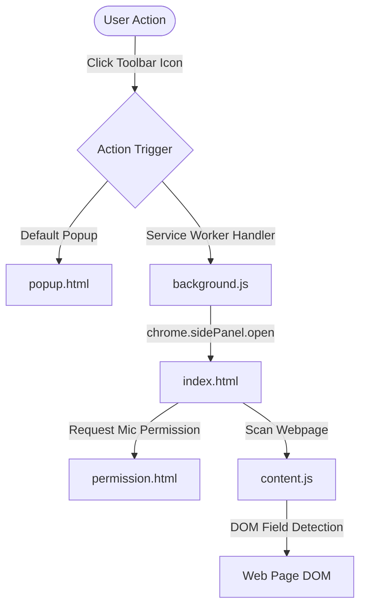
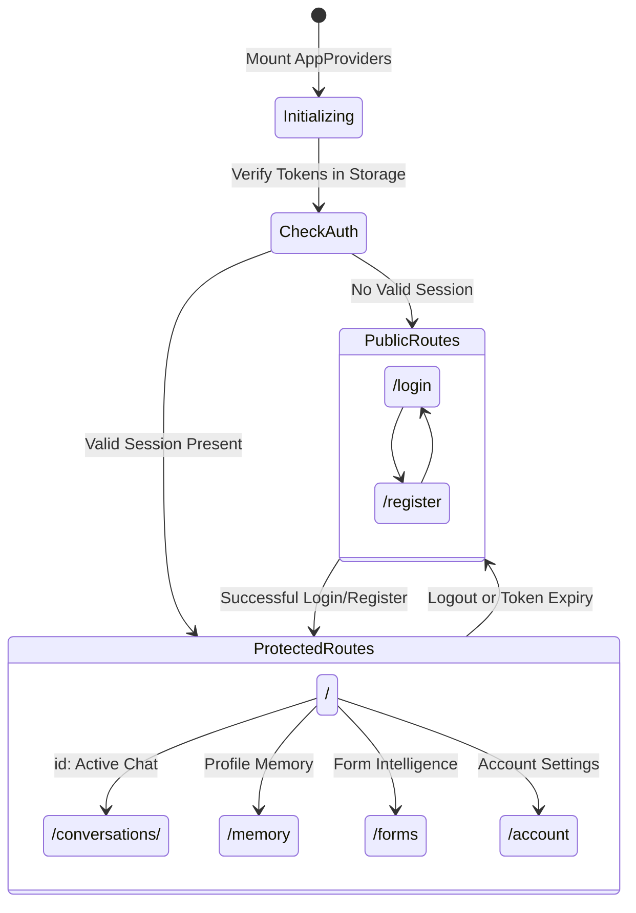
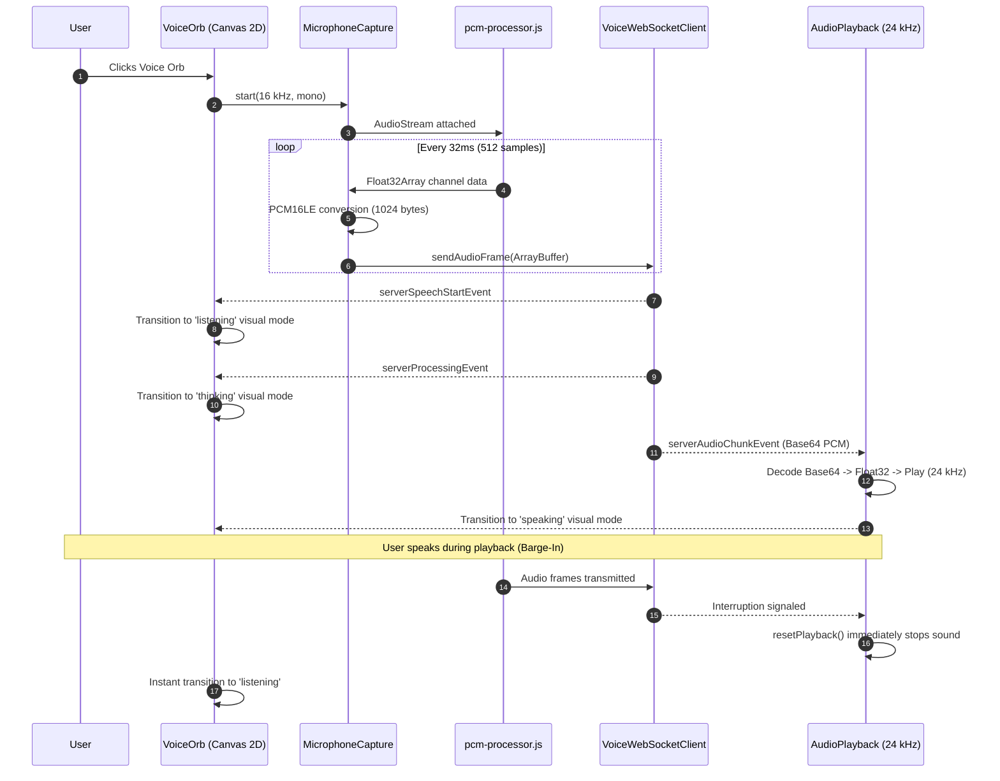

# BhashaAgent Frontend — Technical Architecture & Developer Guide

Welcome to the **BhashaAgent** frontend codebase. This document serves as the comprehensive, ground-truth technical guide for developers working on the client application.

BhashaAgent is a multilingual, AI-powered browser assistant built as a **Chrome Extension (Manifest V3)** using **React 18**, **TypeScript 5**, **Tailwind CSS v4**, and **Vite 8**. It enables users to converse naturally in Indian languages (English, Hindi, Marathi, and Hinglish), automate webpage form filling with human-in-the-loop approvals, manage persistent profile memories, and interact via a real-time voice interface powered by an interactive Canvas Voice Orb.

---

## Table of Contents

1. [System Overview & Capabilities](#1-system-overview--capabilities)
2. [Technology Stack & Architectural Rationale](#2-technology-stack--architectural-rationale)
3. [High-Level Architecture & Extension Topology](#3-high-level-architecture--extension-topology)
4. [Complete Post-Cleanup Directory Structure](#4-complete-post-cleanup-directory-structure)
5. [Chrome Extension Manifest V3 Architecture](#5-chrome-extension-manifest-v3-architecture)
   - [Background Service Worker](#background-service-worker)
   - [Content Script (DOM Automation)](#content-script-dom-automation)
   - [Side Panel Application](#side-panel-application)
   - [Toolbar Action Popup](#toolbar-action-popup)
   - [Dedicated Permission Page](#dedicated-permission-page)
   - [Web Accessible Resources (AudioWorklet)](#web-accessible-resources-audioworklet)
6. [Application Lifecycle & Routing Architecture](#6-application-lifecycle--routing-architecture)
7. [Core Subsystems & Feature Modules](#7-core-subsystems--feature-modules)
   - [Authentication & Single-Flight Token Storage](#a-authentication--single-flight-token-storage)
   - [Conversations & Chat Lifecycle](#b-conversations--chat-lifecycle)
   - [Real-Time Voice Pipeline & Voice Orb](#c-real-time-voice-pipeline--voice-orb)
   - [Form Intelligence & Webpage Form Detection](#d-form-intelligence--webpage-form-detection)
   - [Browser DOM Action Execution Engine](#e-browser-dom-action-execution-engine)
   - [Profile Memory & Proposal Review Workflow](#f-profile-memory--proposal-review-workflow)
8. [API Services & Network Contracts](#8-api-services--network-contracts)
   - [HTTP REST Endpoints](#http-rest-endpoints)
   - [Voice WebSocket Protocol (bhasha.voice.v1)](#voice-websocket-protocol-bhashavoicev1)
   - [Browser Automation Protocol (bhasha.browser.v1)](#browser-automation-protocol-bhashabrowserv1)
9. [UI Design System & Styling Architecture](#9-ui-design-system--styling-architecture)
10. [Environment Configuration](#10-environment-configuration)
11. [Development, Build & Extension Packaging](#11-development-build--extension-packaging)
12. [Automated Testing Suite (108 Tests)](#12-automated-testing-suite-108-tests)
13. [Security, Permissions & CSP](#13-security-permissions--csp)
14. [Developer Contribution Checklist](#14-developer-contribution-checklist)

---

## 1. System Overview & Capabilities

The BhashaAgent client provides four primary capabilities:

1. **Multilingual Conversation Interface**: Full natural-language chat supporting English (`en`), Hindi (`hi`), Marathi (`mr`), and Hinglish (`hi-Latn`), with turn-by-turn message editing, correction tracking, and revision history.
2. **Real-Time Voice Assistant**: Full-duplex voice interface featuring an interactive particle-mesh Voice Orb, 16 kHz microphone capture via an isolated `AudioWorklet`, streaming binary PCM audio over WebSockets, low-latency Gnani Timbre TTS playback at 24 kHz, and instant barge-in interruption.
3. **Webpage Form Intelligence**: Automatic detection of HTML form elements (`input`, `select`, `textarea`, custom fields), fuzzy heuristic field matching against approved user profile memories, field-level confidence indicators, and human-in-the-loop value approvals.
4. **Verified DOM Execution Engine**: Strict-allowlist DOM manipulation (`SET_VALUE`, `SELECT_OPTION`, `CLICK`, `CHECK`, `UNCHECK`, `SUBMIT`) executing directly inside webpage contexts through isolated content scripts, with Devanagari script preservation and full error categorization.

---

## 2. Technology Stack & Architectural Rationale

| Technology | Version | Purpose & Rationale |
| :--- | :---: | :--- |
| **React** | `18.3.1` | UI component tree and state management. Concurrent rendering features and memoized hooks prevent audio/DOM execution stutter. |
| **TypeScript** | `5.9.3` | End-to-end type safety, Zod schema inference, and contract consistency with the BhashaAgent backend. Strict mode enabled (`tsconfig.app.json`). |
| **Vite** | `8.3.5` | Multi-entry Rollup bundler configured specifically for Chrome Extension artifacts (`sidepanel`, `popup`, `permission`, `background`, `content`). |
| **Tailwind CSS** | `v4.3.3` | High-performance CSS engine using modern CSS `@theme` tokens and zero runtime overhead. Loaded via `@tailwindcss/vite`. |
| **React Router DOM** | `7.18.5` | In-memory routing (`createMemoryRouter`) providing stable, sandboxed navigation inside the Chrome Side Panel and Popup without modifying browser tab history. |
| **Zod** | `4.6.7` | Runtime validation for WebSocket messages, server events, and external API responses to safeguard UI components from malformed payloads. |
| **Lucide React** | `1.66.0` | Consistent, accessible SVG iconography. |
| **AudioWorklet API** | Native W3C | Low-latency audio sampling on a dedicated thread, preventing UI lockups from dropping 16 kHz audio frames. |
| **Node Test Runner & TSX** | `Node 20+` / `tsx 4.23` | Native Node test runner with TypeScript execution for ultra-fast, zero-dependency unit and integration testing. |

---

## 3. High-Level Architecture & Extension Topology

The following diagram illustrates how the five extension execution contexts communicate with each other, the host webpage, and the BhashaAgent backend:

```mermaid
flowchart TB
    subgraph ChromeBrowser["Chrome Browser Execution Boundaries"]
        subgraph WebPage["Active Web Page Context"]
            DOM["Webpage DOM Elements"]
            CS["Content Script<br/>(content.js)"]
        end

        subgraph ServiceWorker["Extension Background"]
            SW["Background Service Worker<br/>(background.js)"]
        end

        subgraph ExtensionSurfaces["Extension UI Surfaces"]
            SP["Side Panel Application<br/>(index.html / App.tsx)"]
            POP["Toolbar Popup<br/>(popup.html / PopupApp.tsx)"]
            PERM["Permission Setup Tab<br/>(permission.html)"]
        end

        subgraph WebAudio["Web Audio Architecture"]
            MIC["Microphone Hardware"]
            AW["PCM AudioWorklet<br/>(pcm-processor.js)"]
            CTX["AudioContext (24 kHz)<br/>Gnani TTS Playback"]
        end
    end

    subgraph Backend["BhashaAgent Backend Server (port 5000)"]
        API["REST Endpoints<br/>(/api/v1/*)"]
        WS["Voice Gateway WebSocket<br/>(/api/v1/voice/ws)"]
    end

    DOM <--> |DOM Query & Fill Actions| CS
    CS <--> |chrome.tabs.sendMessage| SP
    CS <--> |chrome.runtime.sendMessage| SW
    SW <--> |chrome.sidePanel.open| SP
    SP <--> |chrome.tabs.create| PERM

    MIC --> AW
    AW --> |16 kHz PCM16LE| SP
    SP --> |Binary Audio Frames| WS
    WS --> |TTS Audio Chunks (24 kHz)| SP
    SP --> CTX

    SP <--> |REST HTTP + Bearer Auth| API
    POP <--> |REST HTTP + Bearer Auth| API
```

---

## 4. Complete Post-Cleanup Directory Structure

The following tree represents the complete post-cleanup frontend codebase:

```text
client/
├── .env.example                          # Template for environment configuration
├── .gitignore                            # Git exclusion rules
├── eslint.config.js                      # Flat ESLint configuration (typescript-eslint, react-hooks)
├── index.html                            # Chrome Side Panel HTML entry point
├── manifest.json                         # Canonical Chrome Extension Manifest V3 configuration
├── package.json                          # Dependencies, scripts, and build targets
├── package-lock.json                     # Deterministic dependency lockfile
├── permission.html                       # Dedicated full-tab microphone setup entry point
├── popup.html                            # Chrome Extension toolbar popup HTML entry point
├── tsconfig.json                         # TypeScript root solution configuration
├── tsconfig.app.json                     # TypeScript application configuration (DOM, ESNext, strict)
├── tsconfig.node.json                    # TypeScript node configuration (Vite & build tooling)
├── vite.config.ts                        # Multi-entry Vite bundler configuration
│
├── public/                               # Static assets served directly / copied to dist
│   ├── ai.html                           # Visual reference demonstration of Voice Orb
│   ├── pcm-processor.js                  # Dedicated AudioWorklet processor (web accessible)
│   └── icons/
│       ├── Logo.png                      # Master branding logo (1254 x 1254)
│       ├── icon16.png                    # Chrome toolbar icon (16 x 16, 97.5% occupancy)
│       ├── icon32.png                    # High-DPI toolbar icon (32 x 32)
│       ├── icon48.png                    # Extensions management icon (48 x 48)
│       └── icon128.png                   # Chrome Web Store & installation icon (128 x 128)
│
├── scripts/
│   ├── generate-icons.ps1                # PowerShell script for regenerating icon resolutions
│   └── prepare-extension.js              # Post-build packaging script (manifest, icons, worklet)
│
├── src/                                  # Application source code
│   ├── index.css                         # Canonical Tailwind v4 design tokens and base styles
│   │
│   ├── app/                              # Top-level React roots & routing
│   │   ├── App.tsx                       # Side Panel root application component
│   │   ├── PopupApp.tsx                  # Toolbar popup root application component
│   │   ├── router.ts                     # In-memory router instances (Side Panel & Popup)
│   │   └── providers/
│   │       └── AppProviders.tsx          # Composed Auth and Conversation providers
│   │
│   ├── background/                       # Chrome Background Service Worker
│   │   └── index.ts                      # Side panel opener, tab context provider, runtime router
│   │
│   ├── components/                       # Shared design system components
│   │   ├── RouteLoadingFallback.tsx      # Skeleton loader during lazy chunk hydration
│   │   ├── common/
│   │   │   └── BhashaLogo.tsx            # Standardized brand logo component (/icons/Logo.png)
│   │   └── layout/
│   │       └── ProtectedRoute.tsx        # Authentication route guard with session verification
│   │
│   ├── content/                          # Webpage Content Script
│   │   └── index.ts                      # DOM form scanner, element resolver, and action executor
│   │
│   ├── features/                         # Modular domain features
│   │   ├── auth/                         # Authentication & Session Management
│   │   │   ├── components/               # LoginForm, RegisterForm, PasswordField, AuthLayout, AuthError
│   │   │   ├── context/                  # AuthContext, AuthProvider, context definition
│   │   │   ├── hooks/                    # useAuth hook
│   │   │   ├── pages/                    # LoginPage, RegisterPage, AccountPage
│   │   │   ├── services/                 # auth.service.ts, token-storage.ts (mutex refresh)
│   │   │   └── types/                    # auth.types.ts (User, AuthSession, AuthState)
│   │   │
│   │   ├── browser/                      # Browser Form Automation & DOM Tracking
│   │   │   ├── components/               # BrowserExecutionPanel, BrowserConnectionBanner, ...
│   │   │   ├── hooks/                    # useBrowserConnection, useBrowserExecution, useActiveBrowserForm
│   │   │   ├── services/                 # browser.service.ts, dom-action-executor.ts, tab-context-manager.ts
│   │   │   └── types/                    # browser.types.ts (protocol contracts, fill instructions)
│   │   │
│   │   ├── conversations/                # Multilingual Chat & Orchestration
│   │   │   ├── components/               # MessageList, MessageItem, AssistantMessage, UserMessage,
│   │   │   │                             # ConversationSidebar, MessageComposer, ConversationHeader, ...
│   │   │   ├── context/                  # ConversationProvider, conversation-context-def.ts
│   │   │   ├── hooks/                    # useConversations, useActiveConversation
│   │   │   ├── pages/                    # ConversationPage.tsx (Primary Chat Surface)
│   │   │   ├── services/                 # conversation.service.ts
│   │   │   └── types/                    # conversation.types.ts (Conversation, Message, SupportedLanguage)
│   │   │
│   │   ├── forms/                        # Form Intelligence & Field Mapping
│   │   │   ├── components/               # FormTaskDashboard, FormTaskList, FormFieldList, FormFieldCard,
│   │   │   │                             # ApprovalSnapshotView, ConflictResolutionPanel, MissingFieldsPanel, ...
│   │   │   ├── hooks/                    # useFormTasks, useActiveFormTask
│   │   │   ├── pages/                    # FormIntelligencePage.tsx
│   │   │   ├── services/                 # form.service.ts
│   │   │   └── types/                    # form.types.ts (FormTask, FormField, ApprovalSnapshot)
│   │   │
│   │   ├── memory/                       # Profile Memory & Facts
│   │   │   ├── components/               # MemoryDashboard, ApprovedMemoryList, PendingProposalList,
│   │   │   │                             # EditMemoryModal, CreateProposalModal, DeleteMemoryDialog, ...
│   │   │   ├── hooks/                    # useMemories, useMemoryProposals
│   │   │   ├── pages/                    # MemoryPage.tsx
│   │   │   ├── services/                 # memory.service.ts
│   │   │   └── types/                    # memory.types.ts (ProfileMemory, MemoryProposal)
│   │   │
│   │   └── voice/                        # Real-Time Voice Interface & Audio Pipeline
│   │       ├── audio/                    # microphone-capture.ts, pcm-encoder.ts, audio-playback.ts, audio-resampler.ts
│   │       ├── components/               # VoiceInterface.tsx, VoiceOrb.tsx
│   │       │   └── voice-orb/            # OrbRenderer.ts (Canvas 2D Shader), orb-constants.ts, orb-types.ts
│   │       ├── hooks/                    # useVoiceState.ts, useVoiceOrb.ts, useMicrophonePermission.ts
│   │       ├── services/                 # voice.service.ts, voice-session.service.ts, voice-websocket.service.ts
│   │       ├── types/                    # voice.types.ts, voice.events.ts (Zod schemas)
│   │       └── utils/                    # voice-translations.ts (Multilingual voice localizations)
│   │
│   ├── layouts/                          # Shared surface layouts
│   │   ├── SidePanelLayout.tsx           # Full-height layout with top navigation bar and panel container
│   │   └── PopupLayout.tsx               # Fixed-width compact layout (360 x 520 px)
│   │
│   ├── pages/
│   │   └── popup/
│   │       └── PopupPage.tsx             # Compact quick-status popup page
│   │
│   ├── permission/                       # Dedicated microphone permission handler
│   │   ├── main.tsx                      # Permission entry point
│   │   └── PermissionPage.tsx            # Setup guide with permission check & microphone activation
│   │
│   ├── popup/
│   │   └── main.tsx                      # Toolbar popup entry point
│   │
│   ├── services/api/                     # Centralized API layer
│   │   ├── api-client.ts                 # Fetch client with auto-bearer auth & single-flight refresh
│   │   ├── api-config.ts                 # Base URL resolution & request defaults
│   │   └── api-errors.ts                 # Typed error classes (ApiError, NetworkError, TimeoutError)
│   │
│   └── sidepanel/
│       └── main.tsx                      # Side Panel entry point
│
└── tests/                                # Automated Test Suites (Node Test Runner + TSX)
    ├── auth.test.js                      # Token storage, refresh mutex, password validation
    ├── browser.test.js                   # Phase 9 protocol, DOM executor, Devanagari preservation
    ├── conversation.test.js              # Conversation API, message revision, streaming pagination
    ├── form.test.js                      # Form intelligence, field mapping, approval state machine
    ├── memory.test.js                    # Profile memory proposals, approval flow, CRUD
    └── voice.test.js                     # Phase 10D voice protocol, lifecycle, barge-in, deduplication
```

---

## 5. Chrome Extension Manifest V3 Architecture

The extension is configured through [`client/manifest.json`](file:///c:/Users/Dell/Desktop/AI/client/manifest.json) according to the Manifest V3 specification.



### Background Service Worker
- **Source**: [`client/src/background/index.ts`](file:///c:/Users/Dell/Desktop/AI/client/src/background/index.ts)
- **Output**: `dist/background.js` (Root output, ES module)
- **Responsibilities**:
  1. Listens to `chrome.action.onClicked` to open the Side Panel via `chrome.sidePanel.open({ windowId })`.
  2. Handles runtime messaging for `OPEN_SIDE_PANEL` and `GET_ACTIVE_TAB_CONTEXT`.
  3. Acts as the communications broker when the Side Panel requires active tab metadata (`id`, `url`, `title`).

### Content Script (DOM Automation)
- **Source**: [`client/src/content/index.ts`](file:///c:/Users/Dell/Desktop/AI/client/src/content/index.ts)
- **Output**: `dist/content.js` (Classic script compatible, ES export statements stripped by `prepare-extension.js`)
- **Execution Rules**: Matches `<all_urls>`, runs at `document_idle`.
- **Responsibilities**:
  1. **Field Detection (`DETECT_PAGE_FIELDS`)**: Traverses the DOM for interactive form controls (`input:not([type="hidden"])`, `select`, `textarea`, `[role="checkbox"]`). Extracts stable selectors, labels, placeholders, aria attributes, and current values.
  2. **Action Execution (`EXECUTE_FILL_INSTRUCTIONS`)**: Dispatches input events (`input`, `change`, `blur`) for form controls, selects options by text or value, toggles checkboxes, and clicks submit buttons.

### Side Panel Application
- **Source**: [`client/index.html`](file:///c:/Users/Dell/Desktop/AI/client/index.html) -> [`client/src/sidepanel/main.tsx`](file:///c:/Users/Dell/Desktop/AI/client/src/sidepanel/main.tsx)
- **Manifest Configuration**: `"side_panel": { "default_path": "index.html" }`
- **Responsibilities**: Hosts the primary BhashaAgent workspace. Stays open alongside the user's active browsing tab, allowing simultaneous browsing and AI assistance.

### Toolbar Action Popup
- **Source**: [`client/popup.html`](file:///c:/Users/Dell/Desktop/AI/client/popup.html) -> [`client/src/popup/main.tsx`](file:///c:/Users/Dell/Desktop/AI/client/src/popup/main.tsx)
- **Manifest Configuration**: `"action": { "default_popup": "popup.html" }`
- **Responsibilities**: Renders a lightweight, compact status card displaying authentication state, active conversation snippet, and a one-click button to open the full Side Panel.

### Dedicated Permission Page
- **Source**: [`client/permission.html`](file:///c:/Users/Dell/Desktop/AI/client/permission.html) -> [`client/src/permission/main.tsx`](file:///c:/Users/Dell/Desktop/AI/client/src/permission/main.tsx)
- **Manifest Configuration**: `"options_ui": { "page": "permission.html", "open_in_tab": true }`
- **Architectural Requirement**: Chrome security prohibits microphone permission dialogs from triggering inside iframe-like Side Panels or Popups. The extension opens `permission.html` in a normal top-level tab via `chrome.tabs.create({ url: chrome.runtime.getURL('permission.html') })`, prompts the user via `navigator.mediaDevices.getUserMedia()`, and establishes permanent microphone authorization.

### Web Accessible Resources (AudioWorklet)
- **Source**: [`client/public/pcm-processor.js`](file:///c:/Users/Dell/Desktop/AI/client/public/pcm-processor.js)
- **Manifest Configuration**:
  ```json
  "web_accessible_resources": [
    {
      "resources": ["pcm-processor.js"],
      "matches": ["<all_urls>"]
    }
  ]
  ```
- **Responsibilities**: Serves the AudioWorklet module loaded dynamically into the audio context using `audioContext.audioWorklet.addModule(chrome.runtime.getURL('pcm-processor.js'))`.

---

## 6. Application Lifecycle & Routing Architecture

The frontend uses **in-memory routers** (`createMemoryRouter` from React Router v7) in [`client/src/app/router.ts`](file:///c:/Users/Dell/Desktop/AI/client/src/app/router.ts). This isolates extension navigation from the browser URL address bar.



### Side Panel Routes
- `/login` → [`LoginPage.tsx`](file:///c:/Users/Dell/Desktop/AI/client/src/features/auth/pages/LoginPage.tsx)
- `/register` → [`RegisterPage.tsx`](file:///c:/Users/Dell/Desktop/AI/client/src/features/auth/pages/RegisterPage.tsx)
- `/` or `/conversations` or `/conversations/:conversationId` → [`ConversationPage.tsx`](file:///c:/Users/Dell/Desktop/AI/client/src/features/conversations/pages/ConversationPage.tsx) (Wrapped in [`ProtectedRoute.tsx`](file:///c:/Users/Dell/Desktop/AI/client/src/components/layout/ProtectedRoute.tsx))
- `/memory` → [`MemoryPage.tsx`](file:///c:/Users/Dell/Desktop/AI/client/src/features/memory/pages/MemoryPage.tsx)
- `/forms` → [`FormIntelligencePage.tsx`](file:///c:/Users/Dell/Desktop/AI/client/src/features/forms/pages/FormIntelligencePage.tsx)
- `/account` or `/settings` → [`AccountPage.tsx`](file:///c:/Users/Dell/Desktop/AI/client/src/features/auth/pages/AccountPage.tsx)

---

## 7. Core Subsystems & Feature Modules

### A. Authentication & Single-Flight Token Storage
- **Directory**: [`client/src/features/auth/`](file:///c:/Users/Dell/Desktop/AI/client/src/features/auth/)
- **Core Files**: [`token-storage.ts`](file:///c:/Users/Dell/Desktop/AI/client/src/features/auth/services/token-storage.ts), [`auth.service.ts`](file:///c:/Users/Dell/Desktop/AI/client/src/features/auth/services/auth.service.ts), [`AuthContext.tsx`](file:///c:/Users/Dell/Desktop/AI/client/src/features/auth/context/AuthContext.tsx)
- **Token Management**:
  1. Access tokens and refresh tokens are persisted in `chrome.storage.local` with automatic fallback to `localStorage` during automated tests or standalone dev mode.
  2. **Single-Flight Mutex (`refreshMutexPromise`)**: When multiple concurrent requests encounter an expired access token (`401 Unauthorized`), the client does not fire duplicate refresh calls. Instead, the first request acquires the mutex, invokes `POST /api/v1/auth/refresh`, updates the tokens in storage, and resolves all waiting callers with the new token.

---

### B. Conversations & Chat Lifecycle
- **Directory**: [`client/src/features/conversations/`](file:///c:/Users/Dell/Desktop/AI/client/src/features/conversations/)
- **Primary Page**: [`ConversationPage.tsx`](file:///c:/Users/Dell/Desktop/AI/client/src/features/conversations/pages/ConversationPage.tsx)
- **Key Features**:
  1. **Message Revision & Correction**: Users can edit previous turns via [`MessageCorrectionModal.tsx`](file:///c:/Users/Dell/Desktop/AI/client/src/features/conversations/components/MessageCorrectionModal.tsx). This posts to `POST /api/v1/conversations/:id/messages/:messageId/correct`, creating a tracked correction event that informs the orchestrator of user corrections.
  2. **Language Switching**: The chat header provides instant language toggling (`en`, `hi`, `mr`, `hi-Latn`), synchronizing the user's preferred conversation language across both text and voice modes.

---

### C. Real-Time Voice Pipeline & Voice Orb
- **Directory**: [`client/src/features/voice/`](file:///c:/Users/Dell/Desktop/AI/client/src/features/voice/)
- **Components**: [`VoiceInterface.tsx`](file:///c:/Users/Dell/Desktop/AI/client/src/features/voice/components/VoiceInterface.tsx), [`VoiceOrb.tsx`](file:///c:/Users/Dell/Desktop/AI/client/src/features/voice/components/VoiceOrb.tsx), [`OrbRenderer.ts`](file:///c:/Users/Dell/Desktop/AI/client/src/features/voice/components/voice-orb/OrbRenderer.ts)



#### Audio Specifications
- **Input Sampling**: 16 kHz, 1 Channel (Mono), 16-bit Linear PCM Little-Endian (`pcm16le`).
- **Output Sampling**: 24 kHz, 1 Channel (Mono), Linear PCM decoded into Web Audio `AudioBuffer`.
- **Canvas Voice Orb Renderer**: Written in vanilla Canvas 2D with zero external 3D engine overhead. Emulates smooth organic particle fields, dynamic harmonics, breathing cycles, and visual states:
  - `idle`: Slow, gentle pulsing (0.12 speed, forest green hues).
  - `listening`: Responsive expansion with harmonic vibration (0.42 speed).
  - `thinking`: In-out breathing particle compression (0.22 speed).
  - `speaking`: Rhythmic expansion matching spoken cadence.

---

### D. Form Intelligence & Webpage Form Detection
- **Directory**: [`client/src/features/forms/`](file:///c:/Users/Dell/Desktop/AI/client/src/features/forms/)
- **Primary Page**: [`FormIntelligencePage.tsx`](file:///c:/Users/Dell/Desktop/AI/client/src/features/forms/pages/FormIntelligencePage.tsx)
- **Workflow**:
  1. Dispatches `DETECT_PAGE_FIELDS` to the content script on the active tab.
  2. Receives detected form elements and creates a server `FormTask` (`POST /api/v1/forms`).
  3. Displays fields with confidence indicators (`HIGH`, `MEDIUM`, `LOW`) and source attribution (e.g. Sourced from Approved Profile Memory).
  4. Provides explicit **Approve** and **Reject** controls for each proposed value.
  5. Generates an **Approval Snapshot** requiring final user confirmation before browser execution begins.

---

### E. Browser DOM Action Execution Engine
- **Directory**: [`client/src/features/browser/`](file:///c:/Users/Dell/Desktop/AI/client/src/features/browser/)
- **Services**: [`browser.service.ts`](file:///c:/Users/Dell/Desktop/AI/client/src/features/browser/services/browser.service.ts), [`dom-action-executor.ts`](file:///c:/Users/Dell/Desktop/AI/client/src/features/browser/services/dom-action-executor.ts)
- **Strict Allowlist**: Only predefined safe actions are executed:
  - `SET_VALUE`: Inputs values, dispatches `focus`, `input`, `change`, and `blur` events, and verifies DOM state. Supports Devanagari Hindi, Marathi, and English characters.
  - `SELECT_OPTION`: Selects HTML `<select>` options by value, label, or index.
  - `CLICK`: Simulates trusted mouse clicks on checkboxes, radio buttons, or submit triggers.
  - `CHECK` / `UNCHECK`: Updates boolean state on standard and ARIA checkbox elements.
  - `SUBMIT`: Submits forms only after explicit user confirmation.

---

### F. Profile Memory & Proposal Review Workflow
- **Directory**: [`client/src/features/memory/`](file:///c:/Users/Dell/Desktop/AI/client/src/features/memory/)
- **Primary Page**: [`MemoryPage.tsx`](file:///c:/Users/Dell/Desktop/AI/client/src/features/memory/pages/MemoryPage.tsx) -> [`MemoryDashboard.tsx`](file:///c:/Users/Dell/Desktop/AI/client/src/features/memory/components/MemoryDashboard.tsx)
- **Integrity Guarantee**: BhashaAgent strictly prohibits fabricated user facts. Facts extracted from conversation are held as **PENDING PROPOSALS** until the user explicitly clicks **Approve** in the dashboard. Approved memories can be searched, edited, or deleted at any time.

---

## 8. API Services & Network Contracts

### HTTP REST Endpoints

All HTTP requests pass through [`api-client.ts`](file:///c:/Users/Dell/Desktop/AI/client/src/services/api/api-client.ts) and automatically include `Authorization: Bearer <token>`:

| Service | Method | Endpoint | Description |
| :--- | :---: | :--- | :--- |
| **Auth** | `POST` | `/api/v1/auth/register` | Register new user account |
| **Auth** | `POST` | `/api/v1/auth/login` | Authenticate with email/password |
| **Auth** | `POST` | `/api/v1/auth/refresh` | Refresh expired access token |
| **Auth** | `POST` | `/api/v1/auth/logout` | Revoke active session |
| **Auth** | `GET` | `/api/v1/auth/me` | Inspect current user profile |
| **Conversations** | `GET` | `/api/v1/conversations` | List conversation sessions (paginated) |
| **Conversations** | `POST` | `/api/v1/conversations` | Create a new conversation session |
| **Conversations** | `GET` | `/api/v1/conversations/:id` | Fetch conversation details |
| **Conversations** | `DELETE`| `/api/v1/conversations/:id` | Delete conversation session |
| **Conversations** | `POST` | `/api/v1/conversations/:id/messages` | Send user message |
| **Conversations** | `POST` | `/api/v1/conversations/:id/messages/:mId/correct` | Submit turn correction |
| **Forms** | `POST` | `/api/v1/forms` | Register detected form task |
| **Forms** | `GET` | `/api/v1/forms` | List form intelligence tasks |
| **Forms** | `GET` | `/api/v1/forms/:id` | Fetch form task details |
| **Forms** | `POST` | `/api/v1/forms/:id/fields/:fId/approve` | Approve proposed field value |
| **Forms** | `POST` | `/api/v1/forms/:id/fields/:fId/reject` | Reject proposed field value |
| **Forms** | `POST` | `/api/v1/forms/:id/approve` | Final approval for form task |
| **Memory** | `GET` | `/api/v1/memory` | List approved profile memories |
| **Memory** | `GET` | `/api/v1/memory/proposals` | List pending memory proposals |
| **Memory** | `POST` | `/api/v1/memory/proposals` | Manually create memory proposal |
| **Memory** | `POST` | `/api/v1/memory/proposals/:id/approve` | Approve proposed memory |
| **Memory** | `POST` | `/api/v1/memory/proposals/:id/reject` | Reject proposed memory |
| **Memory** | `DELETE`| `/api/v1/memory/:id` | Delete an approved memory |
| **Memory** | `PATCH` | `/api/v1/memory/:id` | Update an approved memory |
| **Browser** | `POST` | `/api/v1/browser/register` | Register tab execution session |
| **Browser** | `POST` | `/api/v1/browser/instructions` | Fetch instructions for execution |
| **Browser** | `POST` | `/api/v1/browser/executions/:id/acknowledge`| Acknowledge instruction execution |

---

### Voice WebSocket Protocol (`bhasha.voice.v1`)
- **Endpoint**: `ws://<backend-host>/api/v1/voice/ws`
- **Subprotocol**: `bhasha.voice.v1`
- **Client Messages**:
  - `START`: `{ type: "START", conversationId, formTaskId?, language }`
  - `Binary Frame`: `ArrayBuffer` containing 512 samples of 16-bit PCM (1024 bytes).
  - `STOP`: `{ type: "STOP" }`
  - `CANCEL`: `{ type: "CANCEL" }`
  - `UPDATE_FORM_TASK`: `{ type: "UPDATE_FORM_TASK", formTaskId }`
- **Server Events**:
  - `SESSION_STATE`, `SESSION_READY`, `SPEECH_START`, `PROCESSING`, `TRANSCRIPT`, `ASSISTANT_RESPONSE`, `TTS_AUDIO_START`, `TTS_AUDIO_CHUNK`, `TTS_AUDIO_COMPLETE`, `SESSION_CLOSED`, `ERROR`.

---

### Browser Automation Protocol (`bhasha.browser.v1`)
- **Protocol**: `bhasha.browser.v1`
- **Action Allowlist**: `SET_VALUE`, `SELECT_OPTION`, `CLICK`, `CHECK`, `UNCHECK`, `SUBMIT`.

---

## 9. UI Design System & Styling Architecture

The application styling is centralized in [`client/src/index.css`](file:///c:/Users/Dell/Desktop/AI/client/src/index.css) using **Tailwind CSS v4** `@theme` declarations:

```css
@theme {
  /* Brand Palette */
  --color-page-bg: #F7F6F1;          /* Warm Ivory */
  --color-card: #FFFFFF;             /* Pure White */
  --color-divider: #E5E1D8;          /* Warm Stone */
  --color-text-primary: #102A24;     /* Deep Forest Charcoal */
  --color-text-secondary: #252923;   /* Muted Slate */
  --color-text-placeholder: #7B8278; /* Subdued Sage */
  --color-accent: #17483A;           /* Bhasha Forest Green */
  --color-accent-hover: #102A24;

  /* Semantic Feedback */
  --color-success: #1E6B42;
  --color-error: #C5221F;
  --color-warning: #B25000;

  /* Spacing & Radius */
  --spacing-panel: 16px;
  --radius-sm: 6px;
  --radius-md: 10px;
  --radius-lg: 14px;
  --radius-xl: 20px;
}
```

### Brand Logo Component
The application brand logo is standardized in [`client/src/components/common/BhashaLogo.tsx`](file:///c:/Users/Dell/Desktop/AI/client/src/components/common/BhashaLogo.tsx). It references `/icons/Logo.png` with `object-fit: contain` to maintain the master emblem's proportions.

---

## 10. Environment Configuration

Configuration is managed via Vite environment variables. Copy the template to set up local development:

```bash
cp client/.env.example client/.env
```

| Variable | Default Value | Description |
| :--- | :--- | :--- |
| `VITE_API_BASE_URL` | `http://localhost:5000` | Target URL for the BhashaAgent backend server. Used for REST calls and WebSocket connection derivation. |

---

## 11. Development, Build & Extension Packaging

### Prerequisites
- **Node.js**: `v20.x` or later
- **npm**: `v10.x` or later
- **Google Chrome**: Version 116+ (Required for Chrome Side Panel API)

### Commands

```bash
# Install client dependencies
npm --prefix client install

# Run TypeScript compilation check
npm --prefix client run typecheck

# Run automated tests
npm --prefix client test

# Build production extension package
npm --prefix client run build
```

### Loading the Unpacked Extension in Chrome
1. Execute `npm --prefix client run build`.
2. Open Google Chrome and navigate to `chrome://extensions/`.
3. Toggle the **Developer mode** switch in the upper-right corner.
4. Click the **Load unpacked** button.
5. Select the generated `client/dist/` directory.
6. The BhashaAgent icon will appear in the Chrome toolbar. Click the icon to inspect the popup, or open the Chrome Side Panel to access the full assistant.

---

## 12. Automated Testing Suite (108 Tests)

The client features a comprehensive test suite executed with the native Node test runner and TSX:

```bash
npm --prefix client test
```

### Test Coverage Breakdown

| Test Suite | Spec File | Tests Passed | Validated Behaviors |
| :--- | :--- | :---: | :--- |
| **Auth** | `tests/auth.test.js` | **8** | Token persistence, single-flight refresh mutex, Argon2 password rules, ApiError classifications |
| **Browser** | `tests/browser.test.js` | **18** | Protocol v1 validation, DOM action allowlist, Devanagari Hindi/Marathi preservation, selector resolution |
| **Conversations** | `tests/conversation.test.js` | **22** | Pagination, correction submissions, revision history, message dispatch, error handling |
| **Forms** | `tests/form.test.js` | **24** | Field mapping schema validation, approval snapshots, confidence indicator scoring, review flows |
| **Memory** | `tests/memory.test.js` | **16** | Fact proposal creation, approval status machine, rejection transitions, deletion safety |
| **Voice** | `tests/voice.test.js` | **20** | WebSocket lifecycle, segment deduplication, PCM decoding, instant barge-in reset, permanent error handling |
| **Total** | **6 Suites** | **108 Passed** | **Exit code 0, 0 failed, 0 skipped** |

---

## 13. Security, Permissions & CSP

1. **Manifest Permissions**:
   - `sidePanel`: Displays the primary assistant surface alongside browsing tabs.
   - `storage`: Securely caches authentication tokens in `chrome.storage.local`.
   - `activeTab` & `tabs`: Inspects active tab URL and title when initiating form detection.
   - `scripting`: Executes content script DOM extraction.
2. **Content Script Boundary**:
   - Webpage content scripts run in isolated worlds, preventing host page scripts from accessing extension memory or internal tokens.
3. **Content Security Policy (CSP)**:
   - Manifest V3 prohibits remote script execution (`unsafe-eval`). All UI logic, AudioWorklet code, and dependencies are bundled locally in `dist/`.

---

## 14. Developer Contribution Checklist

Before submitting pull requests on the frontend:

- [ ] **Type Check**: Run `npm --prefix client run typecheck` and verify zero TypeScript errors.
- [ ] **Automated Tests**: Run `npm --prefix client test` and confirm all 108 tests pass.
- [ ] **Production Build**: Run `npm --prefix client run build` and ensure `dist/` is cleanly assembled.
- [ ] **No Inlined Secrets**: Never commit real user credentials, API keys, or JWT tokens.
- [ ] **Devanagari Preservation**: Verify that DOM actions and text inputs preserve Indian language characters (Hindi, Marathi, Hinglish).
- [ ] **Extension Verification**: Reload the unpacked extension in Chrome and verify the Side Panel, Popup, and Voice Orb.

