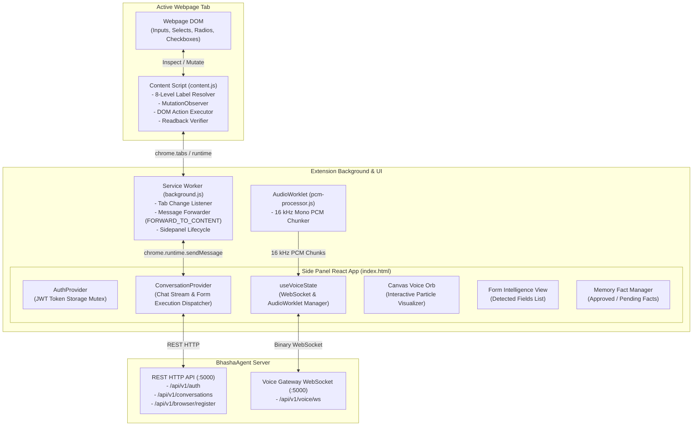

# BhashaAgent Client — Technical Architecture & Developer Guide

Welcome to the **BhashaAgent Client** documentation. This guide details the architecture, implementation, development setup, and testing procedures for the BhashaAgent Chrome Extension (Manifest V3).

The client provides an in-browser AI assistant interface designed for Indian language speakers. It enables natural text and voice conversations in **English**, **Hindi**, **Marathi**, and **Hinglish**, automatically inspects webpage forms, and executes verified DOM updates under a **Direct Execution Policy** without requiring approval modals or executing automatic form submissions.

---

## Table of Contents

- [1. System Overview & Capabilities](#1-system-overview--capabilities)
- [2. Technology Stack](#2-technology-stack)
- [3. High-Level Architecture & Extension Topology](#3-high-level-architecture--extension-topology)
- [4. Source Directory Structure](#4-source-directory-structure)
- [5. Chrome Extension Manifest V3 Architecture](#5-chrome-extension-manifest-v3-architecture)
  - [5.1 Permissions & Host Access](#51-permissions--host-access)
  - [5.2 Background Service Worker](#52-background-service-worker)
  - [5.3 In-Page Content Script](#53-in-page-content-script)
  - [5.4 Web Accessible Resources](#54-web-accessible-resources)
- [6. Application Lifecycle & Routing](#6-application-lifecycle--routing)
  - [6.1 Side Panel](#61-side-panel)
  - [6.2 Toolbar Popup](#62-toolbar-popup)
  - [6.3 Dedicated Microphone Permission Page](#63-dedicated-microphone-permission-page)
- [7. Core Feature Subsystems](#7-core-feature-subsystems)
  - [7.1 Authentication & Single-Flight Token Refresh](#71-authentication--single-flight-token-refresh)
  - [7.2 Multilingual Conversations & Language Switcher](#72-multilingual-conversations--language-switcher)
  - [7.3 Real-Time Voice Pipeline & Voice Orb](#73-real-time-voice-pipeline--voice-orb)
  - [7.4 Webpage Form Detection & DOM Inspection](#74-webpage-form-detection--dom-inspection)
  - [7.5 Form Interaction & Direct Execution Engine](#75-form-interaction--direct-execution-engine)
  - [7.6 Profile Memory Management](#76-profile-memory-management)
- [8. State Management & Persistence](#8-state-management--persistence)
- [9. Backend Communication & Protocol Specifications](#9-backend-communication--protocol-specifications)
- [10. Installation, Development & Packaging](#10-installation-development--packaging)
  - [10.1 Prerequisites](#101-prerequisites)
  - [10.2 Installation Steps](#102-installation-steps)
  - [10.3 Loading into Google Chrome](#103-loading-into-google-chrome)
- [11. Client Environment Variables](#11-client-environment-variables)
- [12. Automated Testing Suite](#12-automated-testing-suite)
- [13. Troubleshooting Guide](#13-troubleshooting-guide)

---

## 1. System Overview & Capabilities

The BhashaAgent client provides four primary capabilities:

1. **Multilingual Sidepanel Chat**: Natural conversational interface supporting English (`en`), Hindi (`hi`), Marathi (`mr`), and Hinglish (`hinglish`), with turn-by-turn message editing, dynamic language detection, and Devanagari Unicode preservation.
2. **Real-Time Voice Assistant**: Full-duplex voice interface featuring an interactive particle-mesh Voice Orb, 16 kHz microphone capture via an isolated `AudioWorklet`, streaming binary PCM audio over WebSockets, low-latency Gnani Timbre TTS playback at 24 kHz, and instant barge-in interruption.
3. **Deterministic Form Inspection**: In-page content script that scans form fields, resolves labels via an 8-level precedence heuristic, groups radio buttons and checkboxes by fieldset legend, tracks dynamic SPA DOM mutations, and masks sensitive inputs (passwords, cards, CVVs).
4. **Direct DOM Execution Engine**: Dispatches allowlisted DOM mutations (`SET_VALUE`, `SELECT_OPTION`, `CHECK`, `UNCHECK`) directly to webpage inputs upon explicit user instruction, performing post-execution readback to guarantee that DOM state matches the user's intent.

---

## 2. Technology Stack

| Technology | Version | Purpose & Rationale |
| :--- | :---: | :--- |
| **React** | `^18.3.1` | Component-based UI for the Side Panel, Popup, and Permission pages. |
| **TypeScript** | `^5.9.3` | Type safety across client domains, API contracts, and browser protocols (`tsconfig.app.json`). |
| **Vite** | `^8.3.5` | Multi-entry Rollup bundler generating extension artifacts (`sidepanel`, `popup`, `permission`, `background`, `content`). |
| **Tailwind CSS** | `^4.3.3` | Utility-first CSS styling via `@tailwindcss/vite`. |
| **React Router DOM**| `^7.18.5` | Hash-based client routing within the side panel interface. |
| **Lucide React** | `^1.66.0` | Accessible, lightweight SVG icon system. |
| **Zod** | `^4.6.7` | Runtime contract validation for API responses and browser messages. |
| **TSX** | `^4.23.15` | Native Node.js TypeScript test execution runner. |

---

## 3. High-Level Architecture & Extension Topology



---

## 4. Source Directory Structure

```text
client/src/
├── app/
│   ├── App.tsx                     # Main React application component
│   └── AppProviders.tsx            # Global provider composition (Auth, Conversation, Form)
├── background/
│   └── index.ts                    # Chrome Manifest V3 Service Worker (background.js)
├── components/
│   ├── ui/                         # Atomic primitives (Button, Input, Badge, Dialog, Spinner)
│   └── layout/                     # Side panel headers, navigation bars, and tabs
├── content/
│   └── index.ts                    # In-page Content Script (DOM scanner & executor)
├── features/
│   ├── auth/                       # Authentication pages, forms, and token storage service
│   ├── browser/                    # DOM action executor, execution summary, browser types
│   ├── conversations/              # Chat stream, Message composer, Language selector
│   ├── forms/                      # Form intelligence page, detected field cards
│   ├── memory/                     # Profile memory manager, proposal review modal
│   └── voice/                      # AudioWorklet controller, Canvas Voice Orb, WebSocket client
├── layouts/                        # Sidepanel, Popup, and Auth layout wrappers
├── pages/                          # ConversationPage, FormIntelligencePage, MemoryPage, AccountPage
├── permission/
│   ├── index.html                  # Microphone permission request page
│   └── permission.tsx              # Permission request handler script
├── popup/
│   ├── index.html                  # Toolbar action popup entry
│   └── popup.tsx                   # Toolbar popup UI logic
├── services/
│   └── api/                        # Axios-like custom API client with interceptors
├── sidepanel/
│   ├── index.html                  # Chrome Side Panel entry HTML
│   └── sidepanel.tsx               # Side Panel React mount
└── types/                          # Shared domain typings (Language, User, Message, Form)
```

---

## 5. Chrome Extension Manifest V3 Architecture

The extension is defined in [client/manifest.json](client/manifest.json) under Chrome Manifest V3 specifications.

### 5.1 Permissions & Host Access

```json
{
  "permissions": [
    "sidePanel",
    "storage",
    "activeTab",
    "tabs",
    "scripting"
  ],
  "host_permissions": [
    "http://localhost:5000/*",
    "http://127.0.0.1:5000/*",
    "<all_urls>"
  ]
}
```

- **`sidePanel`**: Allows rendering the primary conversation and form interface inside Chrome's native side panel.
- **`storage`**: Persists authentication sessions, language preference, and extension state across browser restarts.
- **`activeTab` & `tabs`**: Enables detecting tab navigation and obtaining the active tab URL to associate form tasks.
- **`scripting`**: Injects fallback execution scripts when content scripts are momentarily detached.
- **`host_permissions`**: Allows secure HTTP/WebSocket calls to the backend and content script execution on target web pages.

### 5.2 Background Service Worker

Located at [client/src/background/index.ts](client/src/background/index.ts):
- Listens for `chrome.tabs.onActivated` and `chrome.tabs.onUpdated` events.
- Dispatches `TAB_CHANGED` notifications to the side panel.
- Implements `FORWARD_TO_CONTENT` message routing, verifying content script injection before delivering action payloads.
- Configures `chrome.sidePanel.setPanelBehavior({ openPanelOnActionClick: true })`.

### 5.3 In-Page Content Script

Located at [client/src/content/index.ts](client/src/content/index.ts):
- Injected into all web pages at `document_idle`.
- Bundled as a standalone, zero-dependency IIFE format (`dist/content.js`) to guarantee compatibility across varied website environments.
- Automatically scans DOM inputs and communicates with the extension background worker via `chrome.runtime.sendMessage`.

### 5.4 Web Accessible Resources

- **`pcm-processor.js`**: An `AudioWorkletProcessor` registered in the webpage context to capture 16 kHz linear PCM audio frames without dropping samples during UI renders.

---

## 6. Application Lifecycle & Routing

### 6.1 Side Panel
- The primary interface accessed via Chrome's Side Panel.
- Mounts [client/src/sidepanel/sidepanel.tsx](client/src/sidepanel/sidepanel.tsx).
- Uses `HashRouter` to navigate between:
  - `/` — Active Conversation Chat & Voice Orb
  - `/forms` — Detected Form Fields & Form Intelligence
  - `/memory` — Profile Memory Facts & Proposed Memories
  - `/account` — User Profile & Language Preference Settings
  - `/login` / `/register` — Authentication Screens

### 6.2 Toolbar Popup
- Mounts [client/src/popup/popup.tsx](client/src/popup/popup.tsx) when clicking the extension icon if side panel is not open.
- Provides quick status indicators (active form detected, authentication state) and a button to launch the full Side Panel.

### 6.3 Dedicated Microphone Permission Page
- Google Chrome extensions cannot prompt for microphone permissions directly inside an iframe or side panel.
- When the user first activates voice mode, [client/src/permission/permission.tsx](client/src/permission/permission.tsx) opens in a new browser tab (`permission.html`) to invoke `navigator.mediaDevices.getUserMedia()`, persisting the permission for the extension origin.

---

## 7. Core Feature Subsystems

### 7.1 Authentication & Single-Flight Token Refresh

Authentication is managed by [client/src/features/auth/services/token-storage.service.ts](client/src/features/auth/services/token-storage.service.ts):
- **Storage**: Access tokens and refresh tokens are stored in `chrome.storage.local`.
- **Single-Flight Mutex Coordinator**: When multiple concurrent API calls detect an expired access token, a single-flight mutex ensures only **one** network request is made to `POST /api/v1/auth/refresh`. All pending requests await the same refresh promise, preventing race conditions and invalidating refresh token reuse.

### 7.2 Multilingual Conversations & Language Switcher

- Supported language profiles:
  - `en` — English
  - `hi` — Hindi (हिंदी)
  - `mr` — Marathi (मराठी)
  - `hinglish` — Hinglish
- Persistent preference: Stored in `localStorage` under `bhasha_preferred_lang` and synchronized with user account settings.
- The user can toggle languages on the fly via the language selector pill in the message composer.

### 7.3 Real-Time Voice Pipeline & Voice Orb

Managed by [client/src/features/voice/hooks/useVoiceState.ts](client/src/features/voice/hooks/useVoiceState.ts):
1. **Audio Capture**: Initializes `AudioContext({ sampleRate: 16000 })` and loads `pcm-processor.js`.
2. **WebSocket Session**: Connects to `ws://localhost:5000/api/v1/voice/ws`.
3. **Chunk Streaming**: 16-bit linear PCM chunks are sent as binary WebSocket frames.
4. **Playback**: 24 kHz audio chunks received from Gnani Timbre TTS are queued in an audio buffer and played sequentially.
5. **Canvas Voice Orb**: An interactive visualizer rendering particle nodes whose radius, color, and displacement react to audio frequency data, speech detection, and playback volume.
6. **Barge-In**: When speech energy is detected while the assistant is speaking, an interrupt event is dispatched, immediately stopping audio playback.

### 7.4 Webpage Form Detection & DOM Inspection

Implemented in [client/src/content/index.ts](client/src/content/index.ts):
- **Element Scan**: Queries visible, non-hidden `input`, `select`, `textarea`, and ARIA widgets.
- **8-Level Label Resolution**:
  1. `<label for="id">`
  2. `aria-labelledby`
  3. `aria-label`
  4. Enclosing `<label>` text
  5. Container `<fieldset><legend>` (vital for radio groups and checkbox clusters)
  6. Preceding heading / paragraph tag
  7. `placeholder` attribute
  8. `name` / `id` tokenization
- **Radio Button Grouping**: Clusters radios sharing the same `name` under their common `<legend>` (e.g. `Pizza Size`), enumerating options (`Small`, `Medium`, `Large`) with live `checked` and `disabled` states.
- **Checkbox Grouping**: Clusters multi-checkboxes sharing a `name` under their group `<legend>` (e.g. `Pizza Toppings`), creating an array of options (`Bacon`, `Extra Cheese`, `Onion`, `Mushroom`).
- **MutationObserver**: Monitors DOM subtree modifications, debouncing changes by 350ms to automatically update the backend `FormTask`.

### 7.5 Form Interaction & Direct Execution Engine

Implemented in [client/src/features/browser/services/dom-action-executor.ts](client/src/features/browser/services/dom-action-executor.ts):
- **Direct Execution Policy**: When an explicit user command is processed (e.g. *"customer name mein Adarsh Jha likho"* or *"select all toppings"*), the extension dispatches `EXECUTE_FILL_INSTRUCTIONS` without pausing for an approval modal.
- **Action Execution Priority**:
  1. **Primary**: Dispatches via Background Service Worker (`FORWARD_TO_CONTENT`).
  2. **Secondary**: Direct `chrome.tabs.sendMessage` to active tab.
  3. **Fallback**: `chrome.scripting.executeScript` injected directly into tab.
- **DOM Event Simulation**:
  - Focuses element: `el.focus()`.
  - Mutates value: native setter `Object.getOwnPropertyDescriptor(HTMLInputElement.prototype, 'value').set.call(el, val)`.
  - Fires events: `new Event('input', { bubbles: true })` followed by `new Event('change', { bubbles: true })`.
- **Radio Option Matching**: Matches exact requested option value or label (e.g. `Large`), rather than clicking the first radio element.
- **Checkbox Group Array Handling**: Given an array of values (e.g. `['bacon', 'cheese', 'onion', 'mushroom']`), iterates and checks all matching boxes in the group.
- **Post-Execution Readback Verification**: Compares `element.value` or `element.checked` with the requested value. Reports `SUCCESS` only when verified.
- **No Automatic Submission Boundary**: Submissions (`form.submit()`) are strictly prohibited and rejected by the action executor.

### 7.6 Profile Memory Management

Located at [client/src/features/memory/](client/src/features/memory/):
- Users view, edit, and organize verified personal facts across categories (`IDENTITY`, `CONTACT`, `ADDRESS`, `PREFERENCE`, `PROFESSIONAL`).
- Facts proposed by the AI agent during conversations appear under a **Pending Review** tab for user approval or rejection before being integrated into context.

---

## 8. State Management & Persistence

- **User Session & Tokens**: Managed via `chrome.storage.local` with single-flight mutex coordination.
- **Conversation Stream**: Managed via `ConversationProvider` React state, maintaining optimistic updates, language adaptation, and turn statuses.
- **Language Preference**: Stored in `localStorage['bhasha_preferred_lang']`.
- **Form Intelligence**: Stored in `FormProvider` React state, updating dynamically as tab focus changes.

---

## 9. Backend Communication & Protocol Specifications

### REST API Integration
Base URL configured via `VITE_API_BASE_URL` (default: `http://localhost:5000`):
- `POST /api/v1/auth/login` — User login
- `POST /api/v1/auth/refresh` — Single-flight token refresh
- `GET  /api/v1/conversations` — List user conversations
- `POST /api/v1/conversations/:id/turns` — Submit user turn (text/intent)
- `POST /api/v1/browser/register` — Register scanned webpage form fields
- `GET  /api/v1/memories` — Retrieve approved profile memories

### Browser Automation Protocol (`bhasha.browser.v1`)
Payload for `EXECUTE_FILL_INSTRUCTIONS`:
```typescript
interface ExecuteFillPayload {
  generationId: number;
  actions: Array<{
    actionId: string;
    fieldIdentifier: string;
    actionType: 'SET_VALUE' | 'SELECT_OPTION' | 'CHECK' | 'UNCHECK';
    value: string | number | boolean | Array<string | number | boolean>;
    expectedFieldType?: string;
    requestedTarget?: string;
  }>;
}
```

---

## 10. Installation, Development & Packaging

### 10.1 Prerequisites
- **Node.js**: v20+
- **Google Chrome**: v116+

### 10.2 Installation Steps

1. Navigate to the client directory:
   ```bash
   cd client
   ```
2. Install dependencies:
   ```bash
   npm install
   ```
3. Create local environment configuration:
   ```bash
   cp .env.example .env
   ```
4. Build the extension package:
   ```bash
   npm run build
   ```
   *This compiles TypeScript, bundles React entries via Vite, outputs the standalone content script `dist/content.js`, and copies `manifest.json`, icons, and `pcm-processor.js` into `client/dist/`.*

### 10.3 Loading into Google Chrome

1. Open Chrome and navigate to `chrome://extensions/`.
2. Toggle on **Developer mode** in the top-right corner.
3. Click **Load unpacked** in the top-left corner.
4. Select the `client/dist/` directory.
5. Pin **BhashaAgent** from the Chrome toolbar puzzle menu.

---

## 11. Client Environment Variables

Configuration is loaded from `client/.env`:

| Variable | Required | Description | Default |
| :--- | :---: | :--- | :--- |
| `VITE_API_BASE_URL` | Yes | HTTP/WebSocket URL of the BhashaAgent backend server | `http://localhost:5000` |

---

## 12. Automated Testing Suite

The client test suite validates session storage, single-flight token mutexes, DOM action execution, audio decoding, and voice lifecycle:

```bash
cd client
npm test
```

### Test Coverage Highlights (120 Tests)
- **Token & Session Storage**: Persists/retrieves tokens, single-flight refresh token mutex coordinator under high concurrency.
- **Browser Service Contracts**: Validates `bhasha.browser.v1` protocol compliance, action allowlists, and execution acknowledgements.
- **DOM Action Executor**: Validates `SET_VALUE`, radio selection by value, multi-checkbox group iteration, Devanagari Unicode preservation, and rejections of unauthorized actions.
- **Voice Protocol & Audio Processing**: Base64 audio chunk decoding, Float32 audio conversions, barge-in interruptions, and connection lifecycle resilience.

---

## 13. Troubleshooting Guide

| Issue | Likely Cause | Solution |
| :--- | :--- | :--- |
| **Extension fails to load in Chrome** | `client/dist/` directory not built | Run `npm run build` in `client/` and ensure `dist/manifest.json` exists. |
| **Side panel opens blank** | Backend server not running | Ensure backend is active at `http://localhost:5000`. Check Chrome DevTools console on side panel. |
| **Microphone not working in voice mode** | Permission denied | Open `chrome://extensions/` $\rightarrow$ Details $\rightarrow$ Extension options, or navigate to `permission.html` to grant microphone permission. |
| **Form fields not detected on page** | Webpage has no standard inputs or content script not injected | Refresh the target webpage tab after loading the extension. Note that canvas-based inputs cannot be inspected. |
| **Checkbox or radio not updating** | Outdated extension in browser | Go to `chrome://extensions/` and click the **Reload** button on the BhashaAgent card, then refresh the target webpage tab. |
