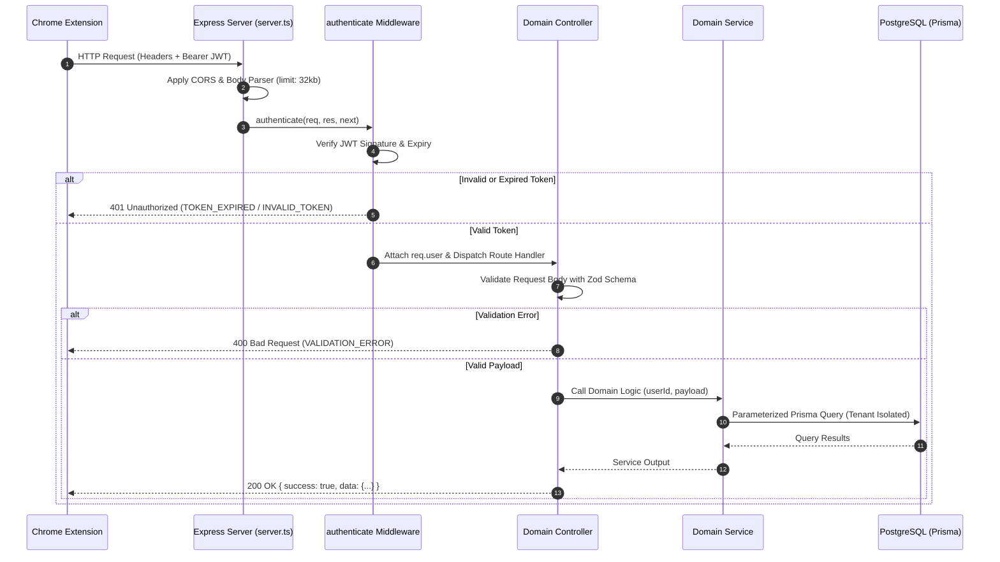
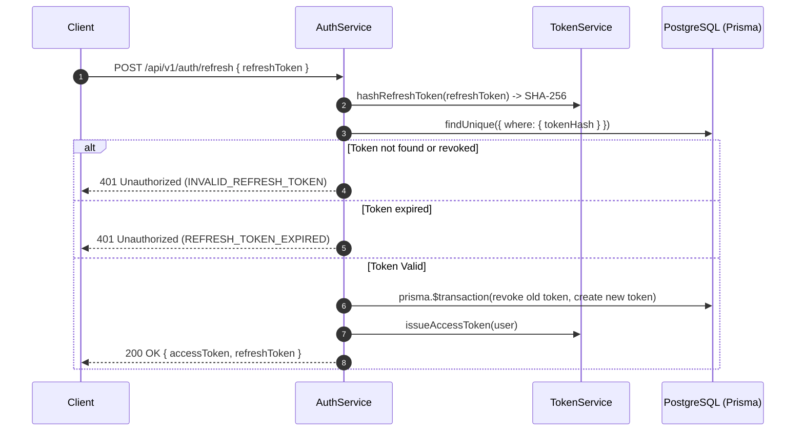
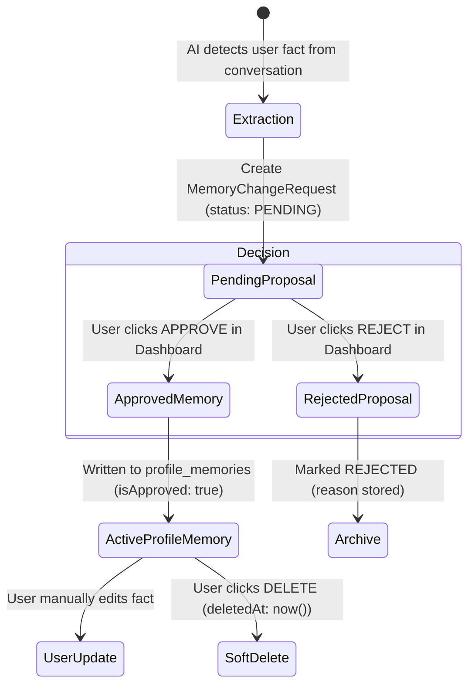
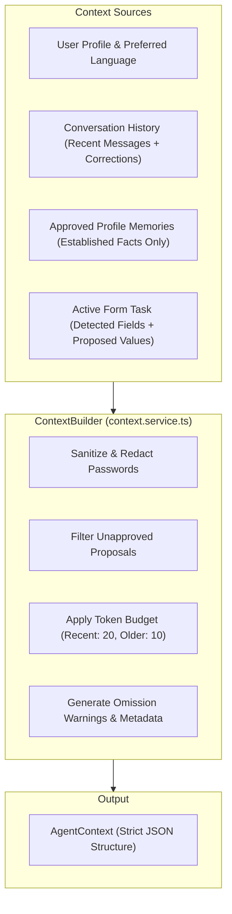
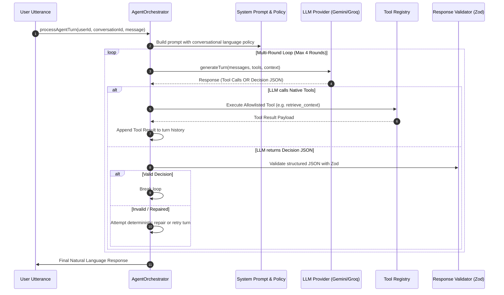
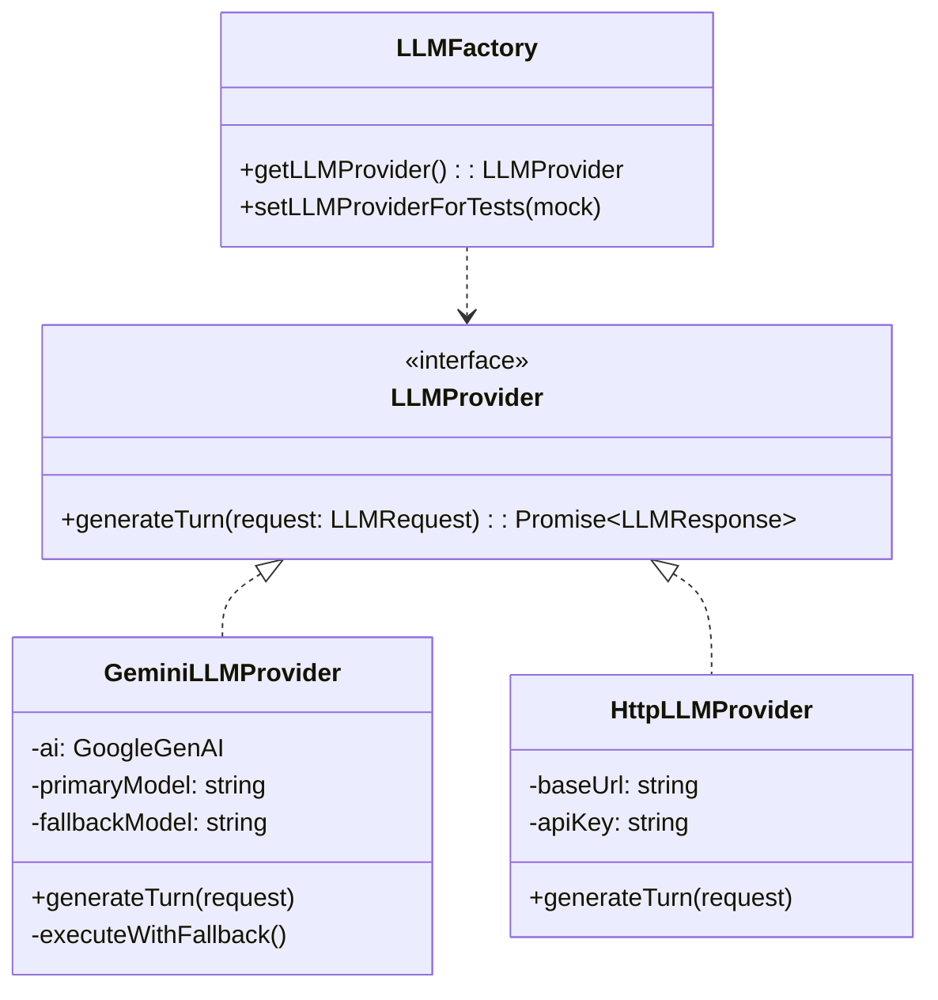
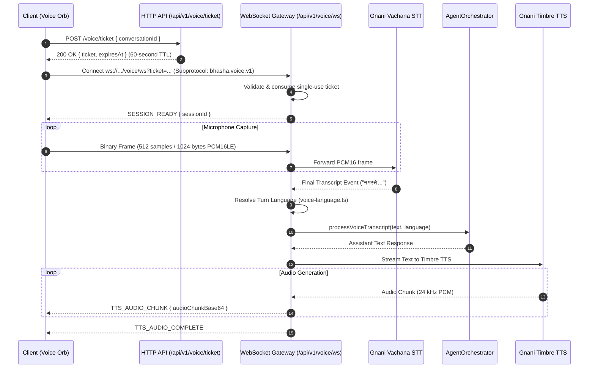
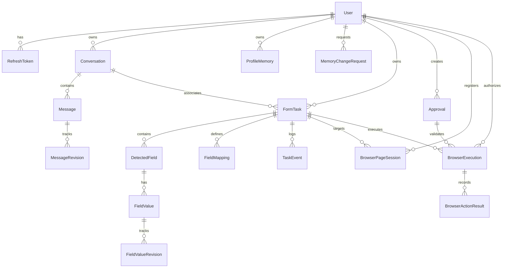

# BhashaAgent Backend — Complete Technical Architecture & Developer Guide

Welcome to the **BhashaAgent Backend** codebase. This document serves as the comprehensive, ground-truth technical guide for developers working on the server application.

BhashaAgent is a multilingual, AI-powered browser assistant designed to help Indian language speakers navigate and complete web tasks. The backend provides secure user authentication, conversation lifecycle tracking with turn-by-turn revisions, persistent profile memory with explicit user verification, dynamic form intelligence and field mapping, multi-turn AI agent orchestration with anti-fabrication grounding, and a real-time full-duplex voice streaming gateway.

---

## Table of Contents

1. [System Overview & Architectural Boundaries](#1-system-overview--architectural-boundaries)
2. [Technology Stack & Rationale](#2-technology-stack--rationale)
3. [Complete Server Folder Structure](#3-complete-server-folder-structure)
4. [Backend Architecture & Request Lifecycle](#4-backend-architecture--request-lifecycle)
5. [Authentication & Authorization](#5-authentication--authorization)
6. [Conversation Management & Revision Tracking](#6-conversation-management--revision-tracking)
7. [Profile Memory Manager](#7-profile-memory-manager)
8. [Form Task Manager & Lifecycle](#8-form-task-manager--lifecycle)
9. [Context Builder](#9-context-builder)
10. [Agent Orchestrator & Multi-Turn Loop](#10-agent-orchestrator--multi-turn-loop)
11. [LLM Provider Abstraction Layer](#11-llm-provider-abstraction-layer)
12. [Browser Integration & Execution Protocol (bhasha.browser.v1)](#12-browser-integration--execution-protocol-bhashabrowserv1)
13. [Voice Gateway & WebSocket Streaming (bhasha.voice.v1)](#13-voice-gateway--websocket-streaming-bhashavoicev1)
14. [Database Architecture & Prisma Schema](#14-database-architecture--prisma-schema)
15. [Complete API Reference](#15-complete-api-reference)
16. [Environment Configuration Reference](#16-environment-configuration-reference)
17. [Security, Error Handling & Reliability](#17-security-error-handling--reliability)
18. [Automated Testing Suite (148 Passing Tests)](#18-automated-testing-suite-148-passing-tests)
19. [Installation, Local Development & Deployment](#19-installation-local-development--deployment)
20. [Troubleshooting Guide](#20-troubleshooting-guide)
21. [Developer Contribution Guidelines](#21-developer-contribution-guidelines)

---

## 1. System Overview & Architectural Boundaries

The BhashaAgent backend is an **Express 5 + TypeScript** service backed by a **PostgreSQL** database managed via **Prisma ORM**. It sits between the user's client extension and external AI/Speech inference engines:

```mermaid
flowchart LR
    Client["Chrome Extension<br/>(Side Panel / Popup / Content Script)"]
    Server["BhashaAgent Server<br/>(Express 5 + WebSocket Gateway)"]
    DB[(PostgreSQL Database<br/>Prisma ORM)]
    LLM["LLM Providers<br/>(Gemini 2.5 Flash / Groq)"]
    Speech["Speech Engines<br/>(Gnani Vachana STT / Timbre TTS)"]

    Client <--> |REST HTTP (/api/v1/*)| Server
    Client <--> |WebSocket (/api/v1/voice/ws)| Server
    Server <--> |TCP (Prisma Client)| DB
    Server <--> |REST / SDK| LLM
    Server <--> |Secure WebSockets| Speech
```

### Architectural Separation: Backend vs. Frontend Boundaries

| Responsibility | Handled By Backend | Handled By Frontend (Client) |
| :--- | :---: | :---: |
| **DOM Inspection & Element Extraction** | ❌ No direct DOM access | ✅ Content script traverses webpage DOM |
| **DOM Value Insertion (`SET_VALUE`, etc.)** | ❌ Produces approved instructions only | ✅ Content script executes DOM events |
| **Form Submission Automation** | ❌ **Strictly prohibited** | ❌ User performs manual final submit |
| **Anti-Fabrication Verification** | ✅ Enforces grounding in user speech | ❌ Validates UI input fields |
| **Audio Frame Encoding & Capture** | ❌ Decodes incoming PCM streams | ✅ AudioWorklet captures 16 kHz PCM |
| **Speech-to-Text & Text-to-Speech Streaming** | ✅ Proxies Gnani Vachana & Timbre | ❌ Decodes & plays 24 kHz audio chunks |
| **Tenant Isolation & Access Control** | ✅ Enforces PostgreSQL ownership barriers | ❌ Manages token storage in Chrome |

---

## 2. Technology Stack & Rationale

| Technology | Verified Version | Purpose & Architectural Rationale |
| :--- | :---: | :--- |
| **Node.js** | `>= 20.x` | Modern server runtime supporting native WebSockets, crypto, and ES2022 features. |
| **TypeScript** | `5.7.3` | Static type safety and strict compiler checks (`strict: true`). |
| **Express** | `5.1.0` | Core HTTP framework with improved error routing and asynchronous middleware handling. |
| **Prisma ORM** | `6.19.0` | Type-safe query builder and database migration engine connecting to PostgreSQL. |
| **PostgreSQL** | `>= 15.x` | Relational data store enforcing foreign key constraints, composite keys, and row-level ACID transactions. |
| **Argon2** | `0.41.1` | Cryptographic password hashing using the Argon2id algorithm (RFC 9106) with memory hardness (19 MiB). |
| **JSONWebToken** | `9.0.2` | Cryptographic signing and verification of short-lived (15m) access tokens. |
| **Google Gen AI SDK** | `2.32.0` | Official `@google/genai` client for primary Gemini models with fallback model execution. |
| **ws** | `8.22.1` | High-throughput WebSocket server managing streaming voice gateway sessions (`bhasha.voice.v1`). |
| **Zod** | `4.1.12` | Runtime schema validation for API payloads, tool arguments, and structured LLM outputs. |
| **express-rate-limit** | `8.2.1` | Brute-force and denial-of-service defense on authentication and AI turn routes. |
| **Dotenv** | `16.4.7` | Environment variable loader supporting multi-path resolution (`.env`, `server/.env`). |

---

## 3. Complete Server Folder Structure

```text
server/
├── .env.example                                      # Environment variable template
├── .gitignore                                        # Excludes node_modules, dist, .env, logs
├── CLEANUP_AUDIT_REPORT.md                           # Formal codebase audit report
├── package.json                                      # Scripts, dependencies, and metadata
├── package-lock.json                                 # Deterministic package dependency tree
├── README.md                                         # This documentation file
├── tsconfig.json                                     # TypeScript compiler configuration
│
├── prisma/
│   ├── schema.prisma                                 # Prisma 6 schema (18 models, 15 enums)
│   └── migrations/                                   # 11 historical linear SQL migrations
│       ├── 20261031000000_initial_schema/
│       ├── 20261031001000_ownership_integrity/
│       ├── 20261031002000_composite_ownership_keys/
│       ├── 20261031003000_message_revisions/
│       ├── 20261031210000_profile_memory_fields/
│       ├── 20261031213000_form_task_manager/
│       ├── 20261102003000_browser_protocol/
│       ├── 20261102003500_browser_registration_idempotency/
│       ├── 20261102004500_browser_retry_idempotency_hash/
│       ├── 20261102005000_browser_retry_scope/
│       └── 20261102005500_browser_registration_request_identity/
│
├── src/                                              # TypeScript Source Code (75 active modules)
│   ├── server.ts                                     # Express server & WebSocket gateway initialization
│   │
│   ├── common/                                       # Cross-cutting concerns
│   │   ├── errors.ts                                 # HttpError class & isHttpError guard
│   │   ├── middleware/
│   │   │   └── authenticate.ts                       # Bearer JWT verification middleware
│   │   └── types/
│   │       └── express.d.ts                          # Ambient typing for Express.Request.user
│   │
│   ├── config/                                       # Core configurations
│   │   ├── database.ts                               # PrismaClient singleton & disconnect handler
│   │   └── environment.ts                            # Validated typed environment configuration
│   │
│   └── modules/                                      # Domain subsystems
│       ├── agent/                                    # Orchestrator & Multilingual AI Agent
│       │   ├── agent.controller.ts                   # POST /api/v1/agent/turn HTTP endpoint
│       │   ├── agent.orchestrator.ts                 # Multi-round tool execution and repair loop
│       │   ├── agent.prompt.ts                       # System prompt, grounding rules, language policy
│       │   ├── agent.routes.ts                       # Agent router with rate limiting
│       │   ├── agent.service.ts                      # processAgentTurn & processVoiceTranscript
│       │   ├── agent.tools.ts                        # Tool definitions & grounding verifiers
│       │   ├── agent.types.ts                        # Orchestrator decision interfaces
│       │   ├── agent.validator.ts                    # Zod schemas for structured LLM decisions
│       │   └── language-detector.ts                  # Unicode script & Indic language detection
│       │
│       ├── auth/                                     # Authentication & Token Management
│       │   ├── auth.controller.ts                    # Register, login, refresh, logout, me handlers
│       │   ├── auth.routes.ts                        # Express routes for /auth & /users
│       │   ├── auth.service.ts                       # User registration, token rotation, revocation
│       │   ├── auth.types.ts                         # Auth request/response interfaces
│       │   ├── auth.validator.ts                     # Zod input validation schemas
│       │   ├── password.service.ts                   # Argon2id password hashing & verification
│       │   └── token.service.ts                      # JWT signing/verification & SHA-256 token hashing
│       │
│       ├── browser/                                  # Browser Automation Protocol (bhasha.browser.v1)
│       │   ├── browser.controller.ts                 # Session register, instructions, ack handlers
│       │   ├── browser.protocol.ts                   # Zod protocol contracts and schemas
│       │   ├── browser.routes.ts                     # Express routes for /api/v1/browser
│       │   ├── browser.service.ts                    # Idempotency hash checks, instruction generation
│       │   └── browser.types.ts                      # Execution and session interfaces
│       │
│       ├── context/                                  # Unified Agent Context Builder
│       │   ├── context.controller.ts                 # POST /api/v1/context/build HTTP endpoint
│       │   ├── context.routes.ts                     # Express router for /api/v1/context
│       │   ├── context.service.ts                    # Context assembly (messages, memory, forms)
│       │   ├── context.types.ts                      # AgentContext schema & diagnostic models
│       │   └── context.validator.ts                  # Zod validation for context build requests
│       │
│       ├── conversations/                            # Conversation & Message Management
│       │   ├── context.service.ts                    # Message cursor pagination queries
│       │   ├── conversation.controller.ts            # CRUD handlers for conversations & messages
│       │   ├── conversation.routes.ts                # Express routes for /api/v1/conversations
│       │   ├── conversation.service.ts               # Conversation lifecycle (active, archived, deleted)
│       │   ├── conversation.validator.ts             # Zod validation for conversations
│       │   └── message.service.ts                    # Message storage & revision history
│       │
│       ├── form-intelligence/                        # Form Intelligence & Field Matching
│       │   ├── field-matcher.service.ts              # Fuzzy heuristic matching against profile facts
│       │   ├── field-normalizer.service.ts           # Label normalization & punctuation stripping
│       │   ├── field-type-validator.service.ts       # HTML input type validation (email, tel, etc.)
│       │   ├── form-intelligence.controller.ts       # Match controller
│       │   ├── form-intelligence.routes.ts           # Router for /api/v1/form-intelligence
│       │   ├── form-intelligence.schemas.ts          # Zod schema for field match requests
│       │   ├── form-intelligence.service.ts          # Match coordination service
│       │   ├── form-intelligence.types.ts            # Mapping suggestion contracts
│       │   ├── option-matcher.service.ts             # Multilingual dropdown option matcher
│       │   └── review-summary.service.ts             # Form review summary builder
│       │
│       ├── form-tasks/                               # Form Task State Machine & Approvals
│       │   ├── form-task.controller.ts               # Task CRUD & field value approval handlers
│       │   ├── form-task.routes.ts                   # Express routes for /api/v1/form-tasks
│       │   ├── form-task.service.ts                  # FormTask state machine & snapshot generation
│       │   └── form-task.validator.ts                # Zod schemas for task lifecycle transitions
│       │
│       ├── llm/                                      # LLM Provider Abstraction Layer
│       │   ├── gemini.provider.ts                    # Google Gen AI SDK client with fallback model
│       │   ├── llm-logger.ts                         # Structured turn logger & sensitive data masking
│       │   ├── llm.errors.ts                         # Typed LLMError hierarchy
│       │   ├── llm.factory.ts                        # Singleton factory (Gemini vs HTTP provider)
│       │   ├── llm.provider.ts                       # Generic OpenAI/Groq compatible HTTP client
│       │   └── llm.types.ts                          # Provider interfaces & message models
│       │
│       ├── memories/                                 # Persistent Profile Memory
│       │   ├── memory-extraction.service.ts          # Candidate fact extraction from conversations
│       │   ├── memory.controller.ts                  # Handlers for approved facts & proposals
│       │   ├── memory.routes.ts                      # Express routes for /api/v1/memories
│       │   ├── memory.service.ts                     # Memory CRUD & explicit approval transitions
│       │   ├── memory.types.ts                       # ProfileMemory and proposal interfaces
│       │   └── memory.validator.ts                   # Zod schemas for memory inputs
│       │
│       ├── users/                                    # User Queries
│       │   └── users.service.ts                      # User profile fetching & sanitization
│       │
│       └── voice/                                    # Real-Time Voice Gateway & Streaming
│           ├── gnani.adapter.ts                      # Gnani Vachana STT WebSocket client
│           ├── timbre.adapter.ts                     # Gnani Timbre TTS WebSocket client
│           ├── timbre.protocol.ts                    # Protocol schemas for Timbre TTS
│           ├── voice-language.ts                     # Turn-level language resolver for voice
│           ├── voice.controller.ts                   # Voice ticket generation endpoint
│           ├── voice.gateway.ts                      # WebSocket gateway (/api/v1/voice/ws)
│           ├── voice.protocol.ts                     # Voice protocol schemas & event builders
│           ├── voice.registry.ts                     # Concurrency, session registry & state machine
│           ├── voice.routes.ts                       # Router for /api/v1/voice
│           └── voice.tickets.ts                      # In-memory single-use ticket generator
│
└── tests/                                            # Test Suites (27 files, 148 passing tests)
    ├── run-tests.js                                  # Test runner bootstrapping dotenv & Node test runner
    ├── support/
    │   └── environment.js                            # Test environment setup, mocks, and DB isolation
    ├── agent/                                        # Orchestrator & anti-fabrication test suites
    ├── auth/                                         # Authentication, token rotation, Argon2 tests
    ├── browser/                                      # Browser automation protocol & idempotency tests
    ├── context/                                      # Context builder & task resolution tests
    ├── conversations/                                # Conversation CRUD & pagination tests
    ├── database/                                     # Database foreign key & transaction tests
    ├── evaluation/                                   # LLM token benchmarking & evaluation scripts
    ├── form-intelligence/                            # Field matching & multilingual option tests
    ├── form-tasks/                                   # Form task approval & state machine tests
    ├── llm/                                          # LLM provider & fallback tests
    ├── memories/                                     # Profile memory CRUD & approval tests
    └── voice/                                        # Voice WebSocket gateway & STT/TTS tests
```

---

## 4. Backend Architecture & Request Lifecycle

### Typical HTTP Request Lifecycle



### Application Initialization Sequence ([`server.ts`](file:///c:/Users/Dell/Desktop/AI/server/src/server.ts))
1. **Environment Validation**: Loads `.env`, validates `DATABASE_URL`, verifies `JWT_ACCESS_SECRET` length (>= 32 chars).
2. **CORS Pipeline**: Permits Chrome Extension origins (`chrome-extension://*`) and local development origins, exposing required headers.
3. **Body Limits**: Enforces a strict `32kb` payload limit on JSON bodies to prevent payload exhaustion attacks.
4. **Router Mounting**: Registers modular domain routers under `/api/v1/*`.
5. **Centralized Error Handler**: Catches typed `HttpError` instances and emits structured `{ success: false, error: { code, message } }` JSON responses.
6. **Dual-Transport Binding**: Binds Express to a Node `http.Server` and attaches the `VoiceGateway` WebSocket server at `/api/v1/voice/ws`.
7. **Graceful Shutdown**: Traps `SIGINT` and `SIGTERM` to close database pools and WebSocket connections cleanly before exiting.

---

## 5. Authentication & Authorization

Implemented in [`server/src/modules/auth/`](file:///c:/Users/Dell/Desktop/AI/server/src/modules/auth/).

### Security Specifications
- **Password Hashing**: Argon2id (`argon2.argon2id`, `memoryCost: 19456` [19 MiB], `timeCost: 2`, `parallelism: 1`).
- **Password Constraints**: Enforced between 12 and 128 characters (`password.service.ts`).
- **Access Tokens**: Short-lived (15 minutes), signed with HMAC-SHA256 containing `userId`, `email`, `role`, and audience `bhashaagent-api`.
- **Refresh Tokens**: Long-lived (7 days), generated via `crypto.randomBytes(40).toString('hex')`.
- **Refresh Token Storage**: **Never stored as plain text**. The server computes `sha256(rawRefreshToken)` and stores only the hash in `refresh_tokens.token_hash`.
- **Single-Flight Rotation**: Consuming a refresh token revokes the token record and issues a fresh pair in an atomic transaction.



---

## 6. Conversation Management & Revision Tracking

Implemented in [`server/src/modules/conversations/`](file:///c:/Users/Dell/Desktop/AI/server/src/modules/conversations/).

### Key Behaviors
- **Soft Deletion**: Conversations are deleted by setting `status = DELETED` and `deletedAt = now()`. Soft-deleted conversations are excluded from queries and cannot be used for new messages or voice sessions.
- **Turn Revision Tracking**: When an existing turn is edited or corrected by the user, the original message is preserved and a `MessageRevision` record is appended with a monotonic `revisionNumber` and `previousContent`.
- **Pagination**: Implements cursor-based pagination ordering by `[createdAt desc, id desc]` in [`context.service.ts`](file:///c:/Users/Dell/Desktop/AI/server/src/modules/conversations/context.service.ts).

---

## 7. Profile Memory Manager

Implemented in [`server/src/modules/memories/`](file:///c:/Users/Dell/Desktop/AI/server/src/modules/memories/).

### Two-Phase Anti-Fabrication Memory Architecture

BhashaAgent enforces a strict **Human-in-the-Loop** model. The AI agent can never directly write facts to a user's permanent profile memory.



- **Candidate Proposals**: Extracted facts are stored as `MemoryChangeRequest` with `status: PENDING`.
- **Promotion to Established Memory**: Only when `POST /api/v1/memories/proposals/:id/approve` is called by the authenticated user does the system create or update a `ProfileMemory` record (`isApproved: true`).
- **Composite Key Constraint**: `@@unique([userId, category, key])` prevents duplicate fact keys per user.

---

## 8. Form Task Manager & Lifecycle

Implemented in [`server/src/modules/form-tasks/`](file:///c:/Users/Dell/Desktop/AI/server/src/modules/form-tasks/).

### Form Task State Transitions
A form task tracks a detected webpage form across its lifecycle:
`CREATED` -> `FIELDS_DETECTED` -> `MAPPING_IN_PROGRESS` -> `AWAITING_INFORMATION` -> `REVIEW` -> `AWAITING_FINAL_APPROVAL` -> `APPROVED_FOR_FILLING` -> `COMPLETED` (or `FAILED` / `CANCELLED`).

### Immutability & Approval Snapshots
When a user approves a form task for filling (`POST /api/v1/form-tasks/:id/approve`), the backend compiles an immutable `ApprovalSnapshot` containing:
1. Exact field IDs and stable selectors.
2. Approved string/boolean/number values.
3. The specific task `version`.
4. User identity and timestamp.

If any field value changes afterward, the `version` increments and the snapshot is invalidated, preventing stale or unauthorized DOM filling.

---

## 9. Context Builder

Implemented in [`server/src/modules/context/`](file:///c:/Users/Dell/Desktop/AI/server/src/modules/context/).

The Context Builder compiles an isolated, budget-constrained `AgentContext` object provided to the LLM orchestrator:



### Context Guarantees
- **No Unapproved Memories**: Pending memory proposals are strictly excluded from established facts.
- **Correction Awareness**: Previous message revisions are included so the model knows what was corrected.
- **Budget Truncation**: When conversation history exceeds budget, older turns are pruned and logged in `contextMetadata.omittedItems`.

---

## 10. Agent Orchestrator & Multi-Turn Loop

Implemented in [`server/src/modules/agent/`](file:///c:/Users/Dell/Desktop/AI/server/src/modules/agent/).



### Anti-Fabrication Verifier
In [`agent.tools.ts`](file:///c:/Users/Dell/Desktop/AI/server/src/modules/agent/agent.tools.ts), `propose_field_value` invokes:
```typescript
isValueGroundedInUserUtterance(field, resolvedValue, context)
```
If the LLM attempts to propose a customer name, email, or telephone number that does **not** appear in the user's transcript and is **not** in approved profile memory, the tool call is rejected with an ungrounded value warning.

---

## 11. LLM Provider Abstraction Layer

Implemented in [`server/src/modules/llm/`](file:///c:/Users/Dell/Desktop/AI/server/src/modules/llm/).

### Provider Architecture


- **GeminiLLMProvider**: Connects via `@google/genai`. Features automatic fallback from `gemini-2.5-flash` to `gemini-flash-lite-latest` when receiving rate limits (HTTP 429) or transient server errors (HTTP 503).
- **HttpLLMProvider**: Connects to OpenAI-compatible REST endpoints (e.g. Groq).

---

## 12. Browser Integration & Execution Protocol (bhasha.browser.v1)

Implemented in [`server/src/modules/browser/`](file:///c:/Users/Dell/Desktop/AI/server/src/modules/browser/).

### Protocol Specification
- **Protocol Version**: Strictly `bhasha.browser.v1`.
- **Idempotency Barrier**: Every session registration requires an `idempotencyKey` and stores a SHA-256 `idempotencyHash` computed from `(userId + pageUrl + fingerprint)`. Duplicate registrations return the existing session.
- **Supported Action Allowlist**:
  - `SET_VALUE`: Inputs values, dispatches `focus`, `input`, `change`, `blur`. Preserves Devanagari Hindi and Marathi characters.
  - `SELECT_OPTION`: Matches select elements by text label or value.
  - `CLICK`: Simulates trusted clicks on checkboxes or radio controls.
  - `CHECK` / `UNCHECK`: Updates boolean checkbox state.
  - `SUBMIT`: Submits forms upon explicit user approval.

---

## 13. Voice Gateway & WebSocket Streaming (bhasha.voice.v1)

Implemented in [`server/src/modules/voice/`](file:///c:/Users/Dell/Desktop/AI/server/src/modules/voice/).

### Dual Transport & Real-Time Voice Lifecycle



---

## 14. Database Architecture & Prisma Schema

The database schema is defined in [`server/prisma/schema.prisma`](file:///c:/Users/Dell/Desktop/AI/server/prisma/schema.prisma) and consists of **18 models** and **15 enums**:

### Entity-Relationship Diagram



### Models Summary

| Model | Table Name | Purpose | Key Constraints |
| :--- | :--- | :--- | :--- |
| `User` | `users` | Authenticated user accounts | `email` (unique) |
| `RefreshToken` | `refresh_tokens` | Hashed refresh tokens | `token_hash` (unique), Cascade on User |
| `Conversation` | `conversations` | Conversation sessions | Index on `[userId, lastMessageAt]` |
| `Message` | `messages` | Chat messages (User, Assistant, System) | Cascade on Conversation |
| `MessageRevision` | `message_revisions` | History of edited messages | `@@unique([messageId, revisionNumber])` |
| `ProfileMemory` | `profile_memories` | Approved user profile facts | `@@unique([userId, category, key])` |
| `MemoryChangeRequest` | `memory_change_requests` | Pending candidate memory proposals | Index on `[userId, status]` |
| `FormTask` | `form_tasks` | Detected webpage form task | Versioned, state machine tracking |
| `DetectedField` | `detected_fields` | Form inputs, selects, textareas | `@@unique([formTaskId, fieldIdentifier])` |
| `FieldValue` | `field_values` | Proposed/approved values for fields | Source attribution, confidence score |
| `FieldValueRevision` | `field_value_revisions` | History of field values | Cascade on FieldValue |
| `FieldMapping` | `field_mappings` | Heuristic mappings to memories | `@@unique([formTaskId, detectedFieldId])` |
| `Approval` | `approvals` | Immutable approval snapshots | Stores immutable `approvedSnapshot` JSON |
| `TaskEvent` | `task_events` | Form task audit events | Cascade on FormTask |
| `BrowserPageSession` | `browser_page_sessions` | Registered webpage browser sessions | `@@unique([userId, idempotencyKey])` |
| `BrowserExecution` | `browser_executions` | Authorized DOM fill instructions | `@@unique([userId, idempotencyKey])` |
| `BrowserActionResult` | `browser_action_results` | DOM execution results per field | `@@unique([executionId, fieldId])` |
| `AuditLog` | `audit_logs` | Security and compliance audit log | Index on `[userId, createdAt]` |

---

## 15. Complete API Reference

All protected endpoints require `Authorization: Bearer <access_token>`.

### Authentication & Users

| Method | Endpoint | Auth | Purpose | Payload Summary |
| :--- | :--- | :---: | :--- | :--- |
| `POST` | `/api/v1/auth/register` | No | Register new user | `{ email, password, fullName, preferredLanguage? }` |
| `POST` | `/api/v1/auth/login` | No | Authenticate user | `{ email, password }` |
| `POST` | `/api/v1/auth/refresh` | No | Rotate refresh token | `{ refreshToken }` |
| `POST` | `/api/v1/auth/logout` | No | Revoke active token | `{ refreshToken }` |
| `GET` | `/api/v1/users/me` | Yes | Inspect current user | None |

### Conversations & Messages

| Method | Endpoint | Auth | Purpose | Payload Summary |
| :--- | :--- | :---: | :--- | :--- |
| `POST` | `/api/v1/conversations` | Yes | Create conversation | `{ title?, language? }` |
| `GET` | `/api/v1/conversations` | Yes | List conversations | Query: `limit`, `cursor`, `status` |
| `GET` | `/api/v1/conversations/:id` | Yes | Get conversation details | None |
| `PATCH` | `/api/v1/conversations/:id` | Yes | Update conversation title/status | `{ title?, status? }` |
| `DELETE` | `/api/v1/conversations/:id` | Yes | Soft-delete conversation | None |
| `POST` | `/api/v1/conversations/:id/messages` | Yes | Send message | `{ content, inputMode?, language? }` |
| `GET` | `/api/v1/conversations/:id/messages` | Yes | List messages (paginated) | Query: `limit`, `beforeMessageId` |
| `POST` | `/api/v1/conversations/:id/messages/:mId/correct` | Yes | Correct previous turn | `{ correctedContent }` |

### Profile Memories

| Method | Endpoint | Auth | Purpose | Payload Summary |
| :--- | :--- | :---: | :--- | :--- |
| `GET` | `/api/v1/memories` | Yes | List approved memories | Query: `category`, `search` |
| `GET` | `/api/v1/memories/proposals` | Yes | List pending proposals | Query: `status` (`PENDING`) |
| `POST` | `/api/v1/memories/proposals` | Yes | Create manual proposal | `{ category, key, value }` |
| `POST` | `/api/v1/memories/proposals/:id/approve` | Yes | Approve proposal into memory | None |
| `POST` | `/api/v1/memories/proposals/:id/reject` | Yes | Reject proposal | `{ reason? }` |
| `PATCH` | `/api/v1/memories/:id` | Yes | Update approved memory | `{ value }` |
| `DELETE` | `/api/v1/memories/:id` | Yes | Soft-delete memory | None |

### Form Tasks & Form Intelligence

| Method | Endpoint | Auth | Purpose | Payload Summary |
| :--- | :--- | :---: | :--- | :--- |
| `POST` | `/api/v1/form-tasks` | Yes | Create form task | `{ conversationId, webpageUrl, webpageTitle?, fields? }` |
| `GET` | `/api/v1/form-tasks` | Yes | List form tasks | Query: `status`, `limit` |
| `GET` | `/api/v1/form-tasks/:id` | Yes | Get form task & fields | None |
| `POST` | `/api/v1/form-tasks/:id/fields/:fId/approve` | Yes | Approve field value | None |
| `POST` | `/api/v1/form-tasks/:id/fields/:fId/reject` | Yes | Reject field value | `{ reason? }` |
| `POST` | `/api/v1/form-tasks/:id/approve` | Yes | Create final approval snapshot | `{ expectedVersion }` |
| `POST` | `/api/v1/form-intelligence/match` | Yes | Match fields to memories | `{ fields: [...] }` |

### Agent & Context

| Method | Endpoint | Auth | Purpose | Payload Summary |
| :--- | :--- | :---: | :--- | :--- |
| `POST` | `/api/v1/context/build` | Yes | Build unified context | `{ conversationId, currentMessage }` |
| `POST` | `/api/v1/agent/turn` | Yes | Execute agent AI turn | `{ conversationId, message, formTaskId? }` |

### Browser Automation & Voice

| Method | Endpoint | Auth | Purpose | Payload Summary |
| :--- | :--- | :---: | :--- | :--- |
| `POST` | `/api/v1/browser/register` | Yes | Register browser tab session | `{ formTaskId, pageUrl, fingerprint, idempotencyKey }` |
| `POST` | `/api/v1/browser/instructions` | Yes | Fetch pending fill instructions | `{ pageSessionId, taskVersion }` |
| `POST` | `/api/v1/browser/executions/:id/acknowledge` | Yes | Acknowledge DOM results | `{ results: [...] }` |
| `POST` | `/api/v1/voice/ticket` | Yes | Generate single-use ticket | `{ conversationId, formTaskId?, language? }` |
| `WS` | `/api/v1/voice/ws?ticket=...` | Ticket | Real-time audio streaming | Subprotocol: `bhasha.voice.v1` |

---

## 16. Environment Configuration Reference

Configuration is managed in [`server/src/config/environment.ts`](file:///c:/Users/Dell/Desktop/AI/server/src/config/environment.ts):

| Variable | Required | Default | Purpose |
| :--- | :---: | :---: | :--- |
| `DATABASE_URL` | **Yes** | — | PostgreSQL connection string with `schema=public` |
| `JWT_ACCESS_SECRET` | **Yes** | — | Secret string (minimum 32 characters) for signing JWTs |
| `JWT_ACCESS_EXPIRES_IN` | No | `15m` | Lifetime of access tokens |
| `REFRESH_TOKEN_EXPIRES_IN_DAYS` | No | `7` | Lifetime of refresh tokens in days |
| `PORT` | No | `5000` | Port for the HTTP and WebSocket server |
| `NODE_ENV` | No | `development` | Node execution environment |
| `GEMINI_API_KEY` | Conditional | — | API key for Google Gemini provider |
| `GEMINI_MODEL` | No | `gemini-2.5-flash` | Primary Gemini LLM model |
| `GEMINI_FALLBACK_MODEL` | No | `gemini-flash-lite-latest` | Fallback model used on 429/503 errors |
| `GROQ_API_KEY` | Optional | — | API key for alternative HTTP LLM provider |
| `GROQ_MODEL` | Optional | — | Model name for alternative HTTP LLM provider |
| `GNANI` | Optional | — | Unified API token for Gnani Vachana STT & Timbre TTS |
| `GNANI_TTS_MODEL` | No | `timbre-v3.0` | Gnani TTS model name |
| `GNANI_TTS_VOICE` | No | `Shivani` | Default voice identifier |
| `GNANI_TTS_SAMPLE_RATE` | No | `24000` | Audio output sample rate (24 kHz linear PCM) |
| `TEST_DATABASE_URL` | For Tests | — | Dedicated test database URL (prevents test data polluting dev) |

---

## 17. Security, Error Handling & Reliability

1. **Centralized Error Handling**: All controllers bubble errors up to Express error middleware (`server.ts`). Known HTTP errors inherit from `HttpError` and emit clean error JSON:
   ```json
   {
     "success": false,
     "error": {
       "code": "CONVERSATION_NOT_FOUND",
       "message": "Conversation not found"
     }
   }
   ```
2. **Sensitive Data Masking**: [`llm-logger.ts`](file:///c:/Users/Dell/Desktop/AI/server/src/modules/llm/llm-logger.ts) filters logs via `sanitizeLogValue()`, redacting headers like `authorization`, passwords, and API keys.
3. **Tenant Ownership Integrity**: Database queries verify `where: { userId: req.user.id }` across all models.
4. **Rate Limiting**: Configured using `express-rate-limit` on sensitive routes (`/api/v1/auth/*` and `/api/v1/agent/turn`).

---

## 18. Automated Testing Suite (148 Passing Tests)

### Baseline Verification Result
The test suite runs using Node's native test runner (`node --test`) with TypeScript compilation and PostgreSQL database isolation:

```bash
npm --prefix server test
```

**Verified Test Baseline**: **148 tests passed across 5 test suites (exit code 0, 0 failed, 0 skipped)**.

### Test Directory Breakdown

| Directory | Primary Spec Files | Verified Coverage |
| :--- | :--- | :--- |
| `tests/agent/` | `agent.test.js`, `conversation-form-filling.test.js`, `multilingual-pipeline.test.js`, `e2e-regression-audit.test.js` | Multi-turn loops, tool execution, anti-fabrication grounding, language switching |
| `tests/auth/` | `auth.test.js` | User registration, login, Argon2id validation, token rotation, logout |
| `tests/browser/` | `browser.test.js` | Protocol v1 compliance, idempotency hash, action retry boundaries |
| `tests/context/` | `context.test.js`, `context-task-resolution.test.js` | Context builder, token budgets, approved memory filtering |
| `tests/conversations/`| `conversation.test.js` | Conversation CRUD, pagination, revisions, soft-deletion |
| `tests/database/` | `foundation.test.js` | Foreign keys, composite ownership keys, transactions, rollbacks |
| `tests/form-intelligence/` | `form-intelligence.test.js`, `form-intelligence.integration.test.js` | Heuristic field matching, Devanagari normalization, dropdown option matching |
| `tests/form-tasks/`| `form-task.test.js` | Form task state machine, field value lifecycle, approval snapshots |
| `tests/llm/` | `gemini.test.js`, `gemini-fallback.test.js`, `fallback-observability.test.js`, `tool-calling-parsing.test.js` | Gemini SDK integration, 429 fallback to lite model, structured tool-call parsing |
| `tests/memories/` | `memory.test.js` | Proposal creation, human-in-the-loop approval, fact isolation |
| `tests/voice/` | `voice.test.js`, `multilingual-stt.test.js`, `timbre.test.js` | WebSocket voice gateway, single-use tickets, Gnani STT/TTS adapters, barge-in |

---

## 19. Installation, Local Development & Deployment

### Prerequisites
- **Node.js**: `v20.x` or later
- **PostgreSQL**: `v15.x` or later running on `localhost:5432`

### Setup Instructions

```bash
# 1. Install dependencies
npm --prefix server install

# 2. Configure environment
cp server/.env.example server/.env
# Edit server/.env and provide DATABASE_URL and JWT_ACCESS_SECRET (min 32 chars)

# 3. Validate Prisma Schema
npm --prefix server run db:validate

# 4. Generate Prisma Client
npm --prefix server run db:generate

# 5. Apply Migrations to PostgreSQL
npm --prefix server run db:migrate

# 6. Build the Server
npm --prefix server run build

# 7. Run Automated Tests
npm --prefix server test

# 8. Start the Production Server
npm --prefix server start
```

The server will listen on `http://0.0.0.0:5000` with the Voice WebSocket Gateway available at `ws://0.0.0.0:5000/api/v1/voice/ws`.

---

## 20. Troubleshooting Guide

| Issue | Likely Cause | Verified Resolution |
| :--- | :--- | :--- |
| **Server crashes with `JWT_ACCESS_SECRET must be at least 32 characters`** | `JWT_ACCESS_SECRET` in `.env` is too short or missing. | Generate a secure 32+ character random secret and update `.env`. |
| **Prisma throws `P1001: Can't reach database server`** | PostgreSQL is stopped or credentials in `DATABASE_URL` are incorrect. | Verify PostgreSQL service is running and `DATABASE_URL` credentials are valid. |
| **Voice WebSocket closes with code `1008` (Policy Violation)** | Connecting with an expired or reused voice ticket. | Call `POST /api/v1/voice/ticket` immediately before establishing the WebSocket connection. |
| **LLM returns `UNGROUNDED_VALUE` during form filling** | AI agent attempted to fabricate a field value not present in user speech or memory. | User must explicitly state the value in speech or approve it in Profile Memory first. |
| **Tests fail with `TEST_DATABASE_URL is required`** | `TEST_DATABASE_URL` is missing from `server/.env`. | Define `TEST_DATABASE_URL` pointing to a test database in `server/.env`. |

---

## 21. Developer Contribution Guidelines

When adding new features to the backend:

1. **Keep Controllers Thin**: Controllers should only parse inputs with Zod, extract `req.user.id`, invoke a service, and return standard JSON.
2. **Isolate Database Access in Services**: Perform all Prisma queries inside domain services. Enforce `where: { userId }` on every query.
3. **Add Zod Validators**: Validate all incoming HTTP payloads and WebSocket messages using Zod schemas before passing them to services.
4. **Never Bypass Anti-Fabrication Rules**: When adding agent tools, ensure values are grounded in conversation context or user profile memory.
5. **Preserve Indian Language Scripts**: Ensure string normalizers and database fields preserve Unicode Devanagari text (Hindi and Marathi).
6. **Verify Before Submitting**:
   ```bash
   npm --prefix server run build
   npm --prefix server test
   ```
   Both commands must pass with exit code `0`.

