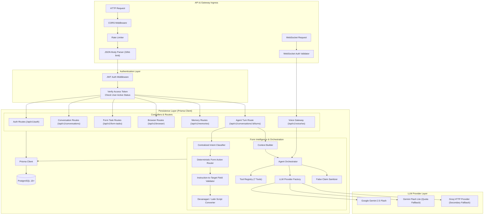
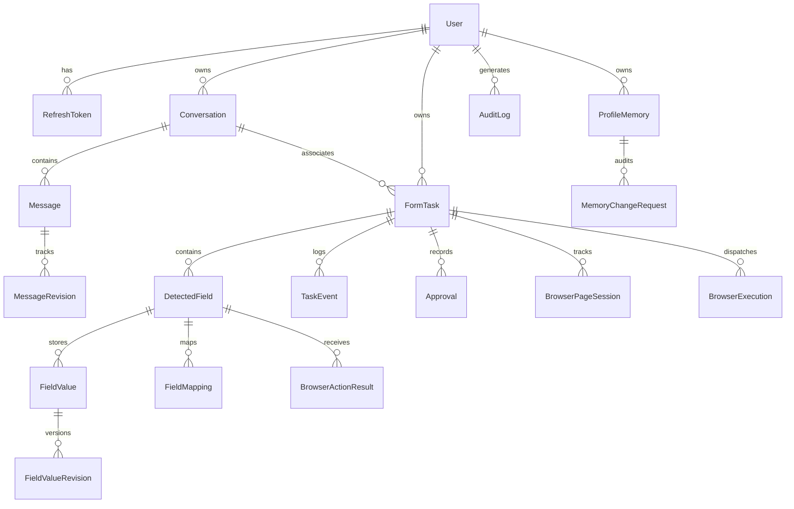

# BhashaAgent Server — Technical Architecture & Developer Guide

Welcome to the **BhashaAgent Server** technical documentation. This guide details the backend orchestration architecture, Express 5 API design, PostgreSQL database schema with Prisma ORM, multi-turn AI agent orchestration, and real-time voice streaming gateway.

The server operates as a secure, authenticated bridge between the user's browser extension, PostgreSQL database, Google Gemini / Groq AI models, and Gnani speech synthesis/recognition services.

---

## Table of Contents

- [1. System Overview & Architectural Boundaries](#1-system-overview--architectural-boundaries)
- [2. Technology Stack & Dependencies](#2-technology-stack--dependencies)
- [3. Server Folder Structure](#3-server-folder-structure)
- [4. Backend Architecture Diagram](#4-backend-architecture-diagram)
- [5. Authentication, Authorization & Token Lifecycle](#5-authentication-authorization--token-lifecycle)
- [6. Complete REST API Reference](#6-complete-rest-api-reference)
  - [6.1 Authentication (`/api/v1/auth`)](#61-authentication-apiv1auth)
  - [6.2 User Profile (`/api/v1/users`)](#62-user-profile-apiv1users)
  - [6.3 Conversations (`/api/v1/conversations`)](#63-conversations-apiv1conversations)
  - [6.4 Agent Turns (`/api/v1/conversations/:id/turns`)](#64-agent-turns-apiv1conversationsidturns)
  - [6.5 Form Tasks (`/api/v1/form-tasks`)](#65-form-tasks-apiv1form-tasks)
  - [6.6 Browser Registration & Execution (`/api/v1/browser`)](#66-browser-registration--execution-apiv1browser)
  - [6.7 Profile Memory (`/api/v1/memories`)](#67-profile-memory-apiv1memories)
  - [6.8 Context Retrieval (`/api/v1/context`)](#68-context-retrieval-apiv1context)
  - [6.9 Voice Session Initialization (`/api/v1/voice`)](#69-voice-session-initialization-apiv1voice)
- [7. Agent Orchestrator & Multi-Turn Loop](#7-agent-orchestrator--multi-turn-loop)
  - [7.1 Context Builder & Token Budgeting](#71-context-builder--token-budgeting)
  - [7.2 Agent Tool Registry (7 Tools)](#72-agent-tool-registry-7-tools)
  - [7.3 Anti-Hallucination Claim Sanitization](#73-anti-hallucination-claim-sanitization)
- [8. Deterministic Form Action Router & Intent Classifier](#8-deterministic-form-action-router--intent-classifier)
  - [8.1 Centralized Intent Classification](#81-centralized-intent-classification)
  - [8.2 Instruction-to-Target Field Validation](#82-instruction-to-target-field-validation)
  - [8.3 Script Conversion & Transliteration](#83-script-conversion--transliteration)
  - [8.4 Multi-Checkbox Group Handling](#84-multi-checkbox-group-handling)
- [9. LLM Provider Layer & Fallback Engine](#9-llm-provider-layer--fallback-engine)
  - [9.1 Gemini 2.5 Flash Integration](#91-gemini-25-flash-integration)
  - [9.2 Dynamic Quota Detection & Model Degradation](#92-dynamic-quota-detection--model-degradation)
  - [9.3 Groq HTTP Provider Secondary Fallback](#93-groq-http-provider-secondary-fallback)
- [10. Voice Gateway & WebSocket Architecture](#10-voice-gateway--websocket-architecture)
- [11. Database Schema & Prisma Architecture](#11-database-schema--prisma-architecture)
  - [11.1 Entity-Relationship Diagram](#111-entity-relationship-diagram)
  - [11.2 Core Data Models](#112-core-data-models)
  - [11.3 Migrations & Database Setup](#113-migrations--database-setup)
- [12. Environment Configuration Reference](#12-environment-configuration-reference)
- [13. Error Handling, Observability & Audit Logging](#13-error-handling-observability--audit-logging)
- [14. Automated Testing Suite](#14-automated-testing-suite)
- [15. Server Troubleshooting Guide](#15-server-troubleshooting-guide)

---

## 1. System Overview & Architectural Boundaries

The BhashaAgent backend is an **Express 5** application written in **TypeScript**, backed by a **PostgreSQL** database managed through **Prisma ORM**.

```mermaid
flowchart LR
    Client["Chrome Extension<br/>(Side Panel / Content Script)"]
    Server["BhashaAgent Server<br/>(Express 5 + WebSocket Gateway)"]
    DB[(PostgreSQL Database<br/>Prisma ORM)]
    Gemini["Google Gemini<br/>(gemini-2.5-flash / lite)"]
    Groq["Groq Cloud API<br/>(gpt-oss-20b)"]
    Gnani["Gnani Speech Services<br/>(Vachana STT / Timbre TTS)"]

    Client <--> |REST HTTP (/api/v1/*)| Server
    Client <--> |WebSocket (/api/v1/voice/ws)| Server
    Server <--> |TCP (Prisma Client)| DB
    Server <--> |HTTPS SDK (@google/genai)| Gemini
    Server <--> |HTTPS REST| Groq
    Server <--> |Secure WebSockets| Gnani
```

### Architectural Separation of Responsibilities

| Responsibility | Handled By Server | Handled By Client (Extension) |
| :--- | :---: | :---: |
| **DOM Inspection & Element Detection** | ❌ Never inspects DOM directly | ✅ Content script traverses webpage DOM |
| **User Authentication & Session Tokens** | ✅ Issues Argon2id + JWT tokens | ✅ Stores tokens via Chrome storage mutex |
| **Form Task & Field State Persistence** | ✅ Persists fields and values in DB | ✅ Submits scanned DOM snapshots |
| **Intent Classification & Form Routing** | ✅ Deterministic router & validator | ❌ Dispatches user instructions |
| **AI Model Invocations & Fallback** | ✅ Gemini SDK, Groq HTTP client | ❌ Never interacts with LLMs directly |
| **DOM Mutation (`SET_VALUE`, etc.)** | ❌ Emits validated instructions | ✅ Simulates native DOM input events |
| **Form Submission Automation** | ❌ **Strictly prohibited** | ❌ **Strictly prohibited** |

---

## 2. Technology Stack & Dependencies

Dependencies from [server/package.json](server/package.json):

| Dependency | Version | Purpose |
| :--- | :---: | :--- |
| **express** | `^5.1.0` | Core HTTP framework with native Promise error handling. |
| **@prisma/client** | `^6.19.0` | Strongly typed PostgreSQL ORM and query builder. |
| **@google/genai** | `^2.32.0` | Official Google Gemini SDK for Gemini 2.5 Flash and Flash Lite. |
| **argon2** | `^0.41.1` | Password hashing using Argon2id with cryptographically random salts. |
| **jsonwebtoken** | `^9.0.2` | Signed JWT access tokens with audience, issuer, and expiration claims. |
| **ws** | `^8.22.1` | Full-duplex WebSocket server powering the real-time voice gateway. |
| **zod** | `^4.1.12` | Schema validation for API payloads, tool calls, and model outputs. |
| **express-rate-limit** | `^8.2.1` | IP-based request throttling protecting authentication and agent turn routes. |
| **dotenv** | `^16.4.7` | Environment variable loader. |
| **prisma** (dev) | `^6.19.0` | Database schema migrations and client generator CLI. |
| **typescript** (dev)| `^5.7.3` | TypeScript compiler targeting ES2022 with CommonJS module emission. |

---

## 3. Server Folder Structure

```text
server/
├── prisma/
│   ├── schema.prisma               # Complete database schema, relations, constraints & indexes
│   └── migrations/                 # Versioned SQL migration history
├── src/
│   ├── common/                     # HttpError class, shared types, utility helpers
│   ├── config/                     # environment.ts (Zod schema config), database.ts (Prisma client)
│   ├── modules/
│   │   ├── agent/                  # Agent orchestrator, prompt generator, tool registry, language detector
│   │   ├── auth/                   # Password hashing, JWT signing, refresh token rotation, auth middleware
│   │   ├── browser/                # Browser registration, execution tracking, protocol schemas
│   │   ├── context/                # Multi-source context builder & dynamic token budgeter
│   │   ├── conversations/          # Conversation lifecycle, message storage, revision tracking
│   │   ├── form-intelligence/      # Intent classifier, form action router, target validator, script converter
│   │   ├── form-tasks/             # FormTask lifecycle, detected field persistence, field value proposals
│   │   ├── llm/                    # Gemini provider, Groq HTTP provider, provider factory, logger
│   │   ├── memories/               # Profile memory CRUD, proposal lifecycle, fact categories
│   │   ├── users/                  # User profile retrieval and updates
│   │   └── voice/                  # WebSocket gateway, Gnani STT/TTS bridges, audio frame assembler
│   └── server.ts                   # Express app setup, CORS, HTTP & WebSocket server initialization
├── tests/                          # 292 automated tests across 9 comprehensive suites
├── package.json
└── tsconfig.json
```

---

## 4. Backend Architecture Diagram



---

## 5. Authentication, Authorization & Token Lifecycle

Implemented in [server/src/modules/auth/](server/src/modules/auth/):
- **Password Hashing**: Uses `argon2.hash(password, { type: argon2.argon2id })` with unique cryptographically random salts. Plaintext passwords are never stored or logged.
- **Access Tokens**: Short-lived JWTs (`JWT_ACCESS_EXPIRES_IN=15m`), signed with `JWT_ACCESS_SECRET` using HMAC SHA-256. Payload contains `userId`, `email`, and standard claims (`iss`, `aud`, `exp`).
- **Refresh Tokens**: Long-lived tokens (`REFRESH_TOKEN_EXPIRES_IN_DAYS=7`). Cryptographic SHA-256 hashes of refresh tokens are stored in the `RefreshToken` database table.
- **Token Rotation**: Each call to `POST /api/v1/auth/refresh` revokes the supplied refresh token and issues a newly generated pair. If an already-revoked refresh token is presented, all refresh tokens for that user are revoked immediately (reuse detection).
- **Ownership Validation**: All conversation, memory, and form endpoints verify that the requested resource belongs to `request.user.id`, returning `404 NOT_FOUND` for foreign resource IDs.

---

## 6. Complete REST API Reference

All successful responses follow the envelope: `{ "success": true, "data": ... }`. Errors return `{ "success": false, "error": { "code": string, "message": string } }`.

### 6.1 Authentication (`/api/v1/auth`)

| Method | Endpoint | Auth | Purpose |
| :--- | :--- | :---: | :--- |
| `POST` | `/api/v1/auth/register` | No | Register a new user account with email, password (min 12 chars), full name, and preferred language. |
| `POST` | `/api/v1/auth/login` | No | Authenticate with email/password; returns access token, refresh token, and user profile. |
| `POST` | `/api/v1/auth/refresh` | No | Exchange a valid refresh token for a new access token and rotated refresh token. |
| `POST` | `/api/v1/auth/logout` | Yes | Revokes the current refresh token session. |
| `POST` | `/api/v1/auth/logout-all` | Yes | Revokes all active refresh token sessions for the authenticated user. |

### 6.2 User Profile (`/api/v1/users`)

| Method | Endpoint | Auth | Purpose |
| :--- | :--- | :---: | :--- |
| `GET` | `/api/v1/users/me` | Yes | Retrieve authenticated user profile, preferred language, and account status. |
| `PATCH`| `/api/v1/users/me` | Yes | Update user profile facts (full name, preferred language). |

### 6.3 Conversations (`/api/v1/conversations`)

| Method | Endpoint | Auth | Purpose |
| :--- | :--- | :---: | :--- |
| `POST` | `/api/v1/conversations` | Yes | Create a new conversation session with optional title and language. |
| `GET` | `/api/v1/conversations` | Yes | List paginated conversations for the user with status filtering. |
| `GET` | `/api/v1/conversations/:id` | Yes | Retrieve conversation details and active form task associations. |
| `PATCH`| `/api/v1/conversations/:id` | Yes | Update conversation title or archive/activate status. |
| `DELETE`| `/api/v1/conversations/:id`| Yes | Soft-delete a conversation session. |
| `GET` | `/api/v1/conversations/:id/messages` | Yes | Retrieve paginated message history with revisions. |

### 6.4 Agent Turns (`/api/v1/conversations/:id/turns`)

| Method | Endpoint | Auth | Purpose |
| :--- | :--- | :---: | :--- |
| `POST` | `/api/v1/conversations/:id/turns` | Yes | Submit a user text turn. Triggers intent classification, deterministic routing, or agent orchestrator loop, returning assistant response and executable `formActions`. |

**Request Body (`agentTurnSchema`)**:
```json
{
  "content": "email address mein adarshjha@gmail.com likho",
  "language": "hinglish",
  "formTaskId": "550e8400-e29b-41d4-a716-446655440000"
}
```

**Response Data**:
```json
{
  "assistantMessageId": "uuid",
  "response": "Maine email address update kar diya hai. Kya aap apna customer name batana chahenge?",
  "intent": { "primary": "FIELD_VALUE_UPDATE", "confidence": 1.0 },
  "language": { "detected": "hinglish", "responseLanguage": "hinglish" },
  "formActions": [
    {
      "actionType": "SET_VALUE",
      "fieldIdentifier": "custemail",
      "value": "adarshjha@gmail.com"
    }
  ]
}
```

### 6.5 Form Tasks (`/api/v1/form-tasks`)

| Method | Endpoint | Auth | Purpose |
| :--- | :--- | :---: | :--- |
| `GET` | `/api/v1/form-tasks/:id` | Yes | Retrieve a FormTask including detected fields, proposals, and lifecycle status. |
| `POST` | `/api/v1/form-tasks/:id/fields/:fieldId/values` | Yes | Directly set a proposed value for a field (`USER_PROVIDED`). |
| `POST` | `/api/v1/form-tasks/:id/map` | Yes | Execute intelligent mapping of user profile facts against detected fields. |

### 6.6 Browser Registration & Execution (`/api/v1/browser`)

| Method | Endpoint | Auth | Purpose |
| :--- | :--- | :---: | :--- |
| `POST` | `/api/v1/browser/register` | Yes | Ingest detected form fields from the in-page content script and upsert `FormTask`. |
| `POST` | `/api/v1/browser/executions/:id/acknowledge` | Yes | Ingest DOM readback verification results after execution. |

### 6.7 Profile Memory (`/api/v1/memories`)

| Method | Endpoint | Auth | Purpose |
| :--- | :--- | :---: | :--- |
| `GET` | `/api/v1/memories` | Yes | List verified user profile facts across categories. |
| `POST` | `/api/v1/memories` | Yes | Create a new profile fact (status: `APPROVED`). |
| `DELETE`| `/api/v1/memories/:id` | Yes | Remove a profile fact from active context. |
| `POST` | `/api/v1/memories/proposals/:id/review` | Yes | User approves or rejects a pending memory candidate proposed by the agent. |

### 6.8 Context Retrieval (`/api/v1/context`)

| Method | Endpoint | Auth | Purpose |
| :--- | :--- | :---: | :--- |
| `GET` | `/api/v1/conversations/:id/context` | Yes | Inspect the assembled context payload built for the LLM. |

### 6.9 Voice Session Initialization (`/api/v1/voice`)

| Method | Endpoint | Auth | Purpose |
| :--- | :--- | :---: | :--- |
| `POST` | `/api/v1/voice/sessions` | Yes | Request a temporary voice streaming session token. |

---

## 7. Agent Orchestrator & Multi-Turn Loop

The Agent Orchestrator ([server/src/modules/agent/agent.orchestrator.ts](server/src/modules/agent/agent.orchestrator.ts)) coordinates conversational turns, context building, tool execution, and response synthesis.

### 7.1 Context Builder & Token Budgeting

Assembles data from 4 isolated sources up to an adaptive token budget (default: 2048 tokens):
1. **Recent Messages**: Up to 15 recent turns in chronological order.
2. **Relevant Older Context**: Vector- or keyword-matched prior turns.
3. **Approved Profile Memories**: Filtered by relevance to the active webpage form.
4. **Active Form Task**: Detected form fields with labels, types, and current DOM states.

### 7.2 Agent Tool Registry (7 Tools)

Located at [server/src/modules/agent/agent.tools.ts](server/src/modules/agent/agent.tools.ts):

| Tool Name | Purpose | Output |
| :--- | :--- | :--- |
| `retrieve_context` | Re-queries the full conversation and form task context. | Context object |
| `retrieve_approved_memories`| Fetches all approved profile facts for the user. | Memory facts array |
| `list_form_tasks` | Lists active form tasks associated with the conversation. | Task summaries |
| `retrieve_form_task` | Retrieves details for a specific `FormTask`. | Form task payload |
| `propose_profile_memory` | Proposes a new candidate fact (`PENDING`) for user review. | Proposed fact record |
| `propose_field_value` | Sets a value for a detected field, validating target matching. | Proposal record |
| `run_intelligent_mapping` | Automatically maps approved memories to empty form fields. | Mapping results array |

### 7.3 Anti-Hallucination Claim Sanitization

Implemented in `sanitizeFalseExecutionClaims()`:
If an LLM response asserts that a form field was updated (e.g. *"I have selected large"* or *"I entered your email"*), the orchestrator inspects `toolResults` and live DOM execution receipts. If no tool ran or DOM verification failed, the false claim is intercepted and replaced with a truthful progress statement.

---

## 8. Deterministic Form Action Router & Intent Classifier

Located at [server/src/modules/form-intelligence/](server/src/modules/form-intelligence/):

### 8.1 Centralized Intent Classification

The classifier ([intent-classifier.ts](server/src/modules/form-intelligence/intent-classifier.ts)) runs **before** target field extraction to prevent generic conversational tokens from polluting form inputs:
- `GENERAL_FORM_ASSISTANCE`: User asks for general form guidance (e.g., *"help me to fill this form"*, *"मला हा फॉर्म भरण्यास मदत करा"*). Returns an overview of form fields without attempting to match `"help"` as an input field.
- `FORM_OVERVIEW`: User asks what the form contains (*"what fields are on this form"*).
- `FIELD_INFORMATION_QUERY`: User asks about a specific field (*"what is customer name"*).
- `FIELD_VALUE_UPDATE`: User provides a concrete value (*"email address mein adarshjha@gmail.com likho"*).
- `CONVERT_FIELD_SCRIPT`: User asks to transliterate a field (*"customer name ko english mein likho"*).
- `SELECT_ALL_CHECKBOXES`: User commands selecting all group items (*"select all toppings"*).
- `OBSERVATION_CORRECTION`: User observes form state (*"see there are still empty"*).
- `GENERAL_CONVERSATION`: Standard chit-chat.

### 8.2 Instruction-to-Target Field Validation

Implemented in [target-field-validator.ts](server/src/modules/form-intelligence/target-field-validator.ts):
- Categorizes fields into entity types: `PERSON_NAME`, `ORGANIZATION_NAME`, `PHONE_NUMBER`, `POSTAL_CODE`, `EMAIL_ADDRESS`, `DATE_OF_BIRTH`, etc.
- Prevents semantic cross-field matching: if the user says *"Add Adarsh Jha as customer name"*, candidate fields like `University Name`, `Company Name`, or `Attach Files` are strictly rejected, even if semantic similarity is high.

### 8.3 Script Conversion & Transliteration

Implemented in [script-converter.service.ts](server/src/modules/form-intelligence/script-converter.service.ts):
- Phonetical character mapping preserving Devanagari Hindi/Marathi consonants, conjuncts, matras, and vowels.
- Clean proper noun transliteration: `आदर्श झा` $\leftrightarrow$ `Adarsh Jha`, `राहुल शर्मा` $\leftrightarrow$ `Rahul Sharma`.
- Never performs dictionary translation or invents surnames.

### 8.4 Multi-Checkbox Group Handling

- When the user asks to select all items in a checkbox set (e.g., *"select all toppings"*):
  - In single grouped fields with `options`: Emits an array of all option values (`["bacon", "cheese", "onion", "mushroom"]`).
  - In individual separate fields: Queries all checkboxes matching the group and emits an update for **every** element in that set.
  - Never short-circuits into a false conversational claim if the user states the boxes are empty.

---

## 9. LLM Provider Layer & Fallback Engine

Located at [server/src/modules/llm/](server/src/modules/llm/):

### 9.1 Gemini 2.5 Flash Integration
- Uses `@google/genai` SDK with native tool definitions.
- Automatic parameter sanitization ensures JSON schema compatibility.

### 9.2 Dynamic Quota Detection & Model Degradation
- **HTTP 429 Classification**: Distinguishes between temporary rate limits with `Retry-After` headers and daily quota exhaustion (`RESOURCE_EXHAUSTED`).
- Upon daily quota exhaustion, the model is marked exhausted for the session, immediately falling back to `gemini-flash-lite-latest` or Groq without freezing turns.

### 9.3 Groq HTTP Provider Secondary Fallback
- Configured via `GROQ_API_KEY` and `GROQ_BASE_URL`.
- Provides an OpenAI-compatible REST chat completions interface with function-calling support.
- Preserves tool definitions across fallbacks so secondary models can still generate valid form proposals.

---

## 10. Voice Gateway & WebSocket Architecture

Located at [server/src/modules/voice/](server/src/modules/voice/):
- **WebSocket Route**: `ws://localhost:5000/api/v1/voice/ws`.
- **Speech-to-Text (STT)**: Bridges incoming 16 kHz binary PCM audio frames to Gnani Vachana streaming ASR.
- **Turn Invocation**: Transcripts trigger `processVoiceTranscript()`, which executes the identical Agent Orchestrator pipeline as text chat turns.
- **Text-to-Speech (TTS)**: Generated response text is streamed to Gnani Timbre TTS (`timbre-v3.0`, Shivani voice) producing 24 kHz linear PCM frames streamed back to the client.

---

## 11. Database Schema & Prisma Architecture

### 11.1 Entity-Relationship Diagram



### 11.2 Core Data Models

- **`User`**: Account identity, Argon2id password hash, role (`USER`, `ADMIN`), and preferred language (`en`, `hi`, `mr`, `hinglish`).
- **`RefreshToken`**: SHA-256 hashed refresh tokens with expiration and revocation metadata.
- **`Conversation`**: Multi-turn chat session with soft-deletion and language preferences.
- **`Message`**: Individual conversational turn (`USER`, `ASSISTANT`, `SYSTEM`) with detected language metadata and revision history.
- **`ProfileMemory`**: Two-phase verified user facts categorized by `IDENTITY`, `CONTACT`, `ADDRESS`, `PREFERENCE`, or `PROFESSIONAL`.
- **`FormTask`**: Active webpage form context bound to a conversation and webpage URL.
- **`DetectedField`**: Scanned form input with label, inputType, elementType, options JSON, sensitivity classification, and order.
- **`FieldValue`**: Current and proposed values for a field with confidence score, source (`USER_PROVIDED`, `APPROVED_PROFILE_MEMORY`), and execution status (`READY`, `EXECUTED`, `FAILED`).
- **`BrowserPageSession`**: Tracks the in-page content script connection for the active tab.

### 11.3 Migrations & Database Setup

```bash
# Apply migrations to development database
npm run db:migrate

# Generate Prisma Client
npm run db:generate

# Deploy migrations to production database (non-destructive)
npm run db:deploy

# Validate Prisma schema
npm run db:validate
```

---

## 12. Environment Configuration Reference

Configuration is validated via Zod in [server/src/config/environment.ts](server/src/config/environment.ts):

| Variable | Required | Default | Purpose |
| :--- | :---: | :---: | :--- |
| `NODE_ENV` | Yes | `development` | Runtime environment (`development`, `production`, `test`). |
| `PORT` | Yes | `5000` | Port for Express HTTP and WebSocket server. |
| `DATABASE_URL` | Yes | - | PostgreSQL connection URL. |
| `TEST_DATABASE_URL`| Yes | - | PostgreSQL test database URL. |
| `JWT_ACCESS_SECRET`| Yes | - | Secret for signing JWT access tokens ($\ge 32$ characters). |
| `JWT_ACCESS_EXPIRES_IN` | No | `15m` | Lifetime of access tokens. |
| `REFRESH_TOKEN_EXPIRES_IN_DAYS` | No | `7` | Lifetime of refresh tokens in days. |
| `GEMINI_API_KEY` | Yes | - | Google Gemini API key. |
| `GEMINI_MODEL` | No | `gemini-2.5-flash` | Primary Gemini model ID. |
| `GEMINI_FALLBACK_MODEL` | No | `gemini-flash-lite-latest` | Secondary Gemini model on quota exhaustion. |
| `GROQ_API_KEY` | No | - | Optional Groq API key for provider fallback. |
| `GROQ_MODEL` | No | `openai/gpt-oss-20b` | Groq fallback model ID. |
| `GNANI` | No | - | Optional Gnani.ai token for STT and TTS streaming. |

---

## 13. Error Handling, Observability & Audit Logging

- **Centralized Error Handler**: Handles all errors via `HttpError`, mapping status codes (`400 VALIDATION_ERROR`, `401 AUTHENTICATION_REQUIRED`, `403 FORBIDDEN`, `404 NOT_FOUND`, `409 CONFLICT`, `429 RATE_LIMITED`, `502 BAD_GATEWAY`).
- **Observability Events**: Structured logging via `logObservabilityEvent()` recording:
  - `INTENT_DETECTED` — User intent classification results
  - `TARGET_VALIDATION_PERMITTED` / `TARGET_VALIDATION_REJECTED` — Instruction-to-target evaluation
  - `FORM_FIELD_MATCHED` & `FORM_VALUE_MATCHED` — Field resolution metrics
  - `FORM_PROPOSAL_CREATED` — Database proposal state
  - `FORM_PROPOSAL_DELIVERED` — Action delivery to browser
- **Audit Logs**: Persistent audit trail stored in `audit_logs` table for authentication, page registration, and field mutations.

---

## 14. Automated Testing Suite

The server includes 292 automated tests across 9 comprehensive suites:

```bash
cd server
npm test
```

### Key Test Suites
- **`intent-classification-routing.test.js`** (27 tests): Validates general form assistance, generic word protection, script transliteration, radio matching, and multi-checkbox group operations.
- **`voice-to-dom-verification.test.js`** (10 tests): Validates end-to-end voice transcription, direct form routing, and DOM verification contracts.
- **`existing-field-script-correction.test.js`** (24 tests): Validates phonetic Devanagari $\leftrightarrow$ Latin transliteration without surname distortion.
- **`instruction-target-validation.test.js`** (12 tests): Validates entity category enforcement (`PERSON_NAME` vs `ORGANIZATION_NAME`, etc.).
- **`provider-fallback.test.js`** (25 tests): Validates Gemini 429 quota handling, Groq HTTP fallback, and false execution claim sanitization.
- **`browser.test.js`** (68 tests): Validates browser page session registration, execution tracking, and acknowledgements.

---

## 15. Server Troubleshooting Guide

| Issue | Likely Cause | Solution |
| :--- | :--- | :--- |
| **`listen EADDRINUSE: 0.0.0.0:5000`** | Another node process is running on port 5000 | Terminate the existing process via task manager or command line: `Stop-Process -Id <PID> -Force`. |
| **`PrismaClientInitializationError`** | PostgreSQL is not running or invalid `DATABASE_URL` | Verify PostgreSQL is active and credentials in `.env` are correct. Test connection with `psql`. |
| **`Gemini API 429 RESOURCE_EXHAUSTED`** | Daily quota exceeded for current API key | The server will automatically degrade to `gemini-flash-lite-latest` or `groq`. Configure `GROQ_API_KEY` in `.env` for seamless fallback. |
| **`NO_FIELD_MATCH` on form instruction** | Field label mismatch or entity category rejected | Verify that target field matches entity category (e.g. personal name for customer name field). Check observability logs for `TARGET_VALIDATION_REJECTED`. |
| **`WebSocket connection failed`** | Port 5000 blocked or token missing | Verify that the server is running on `0.0.0.0:5000` and client passes valid session credentials. |
